# Máximo Das Tintas 🫟 — Relatório Técnico Final

### Modelagem de Banco de Dados · Entrega 2 (modelo lógico, SQL em MySQL e arquitetura analítica)

## Integrantes

| Nome completo do aluno | RGM | Usuário do GitHub |
|---|---|---|
| Gabriel Souza | 46683305 | [gabrieldesouza1830-cell](https://github.com/gabrieldesouza1830-cell) |
| Gabriel Rodrigues da Silva | 46885030 | [GabrielsRodrigues15](https://github.com/GabrielsRodrigues15) (repositório GabrielsRodrigues15/Banco-de-dados-3feira) |
| Ítalo Leal Oliveira | 47837098 | [italoleal567](https://github.com/italoleal567) |
| Vinicius Batista Merencio | 46749527 | [viniciusmerencio0-cpu](https://github.com/viniciusmerencio0-cpu) |

**Curso / Disciplina:** Banco de Dados — Modelagem de Banco de Dados (turma de terça-feira, noturno) · Prof. Cid Andrade.
**SGBD:** MySQL 8.0 (InnoDB, utf8mb4) · **Banco:** loja_tintas_materiais.

## Situação atual do projeto

Atualizado em 11/11/2026. **Vídeo do pitch: até 16/11** — a Máximo Das Tintas não está na lista de seminários presenciais da terça, então o link do vídeo (YouTube, "Não listado", 8 min) vai na [seção 7](#7-apresentação-corporativa-final).

| Item da entrega | Situação | Onde está |
|---|---|---|
| Caracterização, problemas P1–P6, escopo | ✅ pronto | [1.1](#11-revisão-do-modelo-conceitual) |
| Responsável (nome e telefone), endereço, CNPJ | ✅ pronto | [1.1](#evidências-da-organização) |
| Relato da entrevista e levantamento.md | ✅ pronto (troca/devolução confirmada pelo mural da loja) | [levantamento/levantamento.md](levantamento/levantamento.md) |
| Processos, requisitos (RF/RNF) e regras (RN01–RN21) detalhados | ✅ pronto | [1.1](#processos-de-negócio) |
| Revisão do modelo conceitual (Caso A) | ✅ sem apontamentos do professor na E1; revisão feita pelo grupo | [1.1](#revisão-do-modelo-conceitual-caso-a) |
| DER na notação do brModelo | ✅ versão de 22/09 · ⚠️ versão revisada em andamento no brModelo | [entrega-1/DER_brmodelo_22-09-2026.pdf](entrega-1/DER_brmodelo_22-09-2026.pdf) |
| Conversão, PK/FK, normalização, justificativas | ✅ pronto | [1.2 a 1.5](#12-conversão-do-modelo-conceitual-para-o-modelo-lógico) |
| BI e IA com 15 KPIs (fórmula, período, meta, consulta) | ✅ pronto | [1.6](#16-proposta-de-arquitetura-analítica-para-bi-e-ia) |
| Modelo lógico | ✅ gerado do banco · ⚠️ versão no brModelo em andamento | [2](#2-modelo-lógico-relacional) |
| Script SQL com consultas G01–G19 e A01–A13 | ✅ testado no MySQL 8.0.46, sem erros | [docs/script.sql](docs/script.sql) |
| Massa de dados calibrada pela entrevista (467 vendas, ≈ R$ 10 mil/mês) | ✅ pronto | [4](#4-massa-de-dados) |
| Dicionário de dados no modelo 02-03g (HTML único) | ✅ pronto | [docs/dicionario_dados.html](docs/dicionario_dados.html) |
| Testes de restrições | ✅ 17 de 17 operações inválidas rejeitadas | [docs/09_testes_restricoes.sql](docs/09_testes_restricoes.sql) |
| Fotos JPG no repositório | ✅ 11 imagens (2 da fachada, balcão, mural com CNPJ e troca, tela de venda, cadastro de produtos, visita do Ítalo, execução no MySQL Workbench) | [evidencias/](evidencias/) |
| Uso de IA — justificativa e reflexão crítica do grupo | ✅ pronto | [6](#6-uso-de-inteligência-artificial) |
| Commits equilibrados entre os 4 integrantes | ⚠️ conferir | [5](#5-repositório-github) |
| Vídeo do pitch (8 min) | ⚠️ publicar em 16/11 | [7](#7-apresentação-corporativa-final) |

## Sumário

1. [Relatório Técnico Final](#1-relatório-técnico-final)
   1.1 [Revisão do modelo conceitual](#11-revisão-do-modelo-conceitual) · 1.2 [Conversão](#12-conversão-do-modelo-conceitual-para-o-modelo-lógico) · 1.3 [PKs e FKs](#13-definição-de-chaves-primárias-e-estrangeiras) · 1.4 [Normalização](#14-processo-de-normalização-1fn-2fn-e-3fn) · 1.5 [Justificativas](#15-justificativas-técnicas-das-decisões) · 1.6 [BI e IA](#16-proposta-de-arquitetura-analítica-para-bi-e-ia)
2. [Modelo lógico relacional](#2-modelo-lógico-relacional)
3. [Script SQL completo](#3-script-sql-completo)
4. [Massa de dados](#4-massa-de-dados)
5. [Repositório GitHub](#5-repositório-github)
6. [Uso de Inteligência Artificial](#6-uso-de-inteligência-artificial)
7. [Apresentação corporativa final](#7-apresentação-corporativa-final)
8. [Limitações e pontos a validar](#8-limitações-e-pontos-a-validar)
9. [Referências da disciplina](#referências-da-disciplina)

**[Anexo A — Entrega 1 (modelo conceitual)](#anexo-a--entrega-1-modelo-conceitual)**

---

## 1. Relatório Técnico Final

### 1.1 Revisão do Modelo Conceitual

#### Caracterização da organização

- **Nome e natureza:** **Máximo Das Tintas** (razão social MAXIMO DAS TINTAS LTDA - ME, CNPJ 52.489.342/0001-10), loja de pequeno porte do varejo de **tintas, ferramentas e materiais de construção**, com fins lucrativos. Vende ao consumidor final (pessoa física) e a pintores, pequenas construtoras e empresas de reforma (pessoa jurídica). Trabalha com marcas como Suvinil, Bilacor, Tramontina, Ferja, Tigre, Condor, Famastil e Thompson.
- **Contexto e porte (entrevista de 07/11/2026 com a responsável financeira):**

  | Item | Informado |
  |---|---|
  | Equipe | **2 funcionários + 1 intermediário**: os três vendem, atendem, cadastram produtos, preparam tinta na máquina, fazem pedidos e organizam a loja; responsáveis: Pedro, Waldeane e Larissa (financeiro, com escritório) |
  | Faturamento | **R$ 300 a R$ 500 por dia** (≈ R$ 10 mil por mês) |
  | Saída de produtos | **100 a 120 por mês** |
  | Formação de preço | margem sobre o custo: **45% nas tintas**, **65% na maioria dos produtos** e **acima de 100% nos itens pequenos** (pregos etc.); o sistema calcula o preço (campo "% à Vista") e a loja reajusta para acompanhar o mercado |
  | Pagamento | PIX (**5% de desconto**), débito, crédito (**2x a partir de R$ 200, 3x a partir de R$ 400**), dinheiro; **boleto a prazo para obras parceiras** |
  | Entrega | não faz |
  | Troca e devolução | segue o **CDC, art. 18** (substituição, devolução do valor ou abatimento); prazo para reclamar de vício: **30 dias** (não duráveis) e **90 dias** (duráveis, art. 26); **não troca com embalagem aberta nem tinta pigmentada** (mural da loja) |
  | Sistema atual | PDV próprio (vendas, orçamentos, cadastro de produtos com custo); compras pelos sites dos fornecedores; caixa contado na abertura e no fechamento; nada anotado em papel |
  | Expansão | uma loja nova, maior e em melhor localização, está em construção |

- **Problemas e necessidades** (todo problema aparece no DER e tem consulta gerencial; ver a rastreabilidade na [seção 1.6](#16-proposta-de-arquitetura-analítica-para-bi-e-ia)):

  | # | Problema de gestão de informações | Como o modelo resolve | Consultas |
  |---|---|---|---|
  | P1 | Informação espalhada entre o PDV, listas exportadas e os carrinhos dos sites dos fornecedores; orçamentos se perdem | 10 tabelas integradas; orçamento é uma venda com status ORCAMENTO | G13, G14, G16 |
  | P2 | O que está acabando é descoberto pela revisão diária manual da loja | estoque.quantidade_minima + ponto de reposição e cobertura em dias | G05, G06, G10 |
  | P3 | Faltam relatórios gerenciais — a loja pediu o de **aumento de preço dos produtos** | historico_preco (trigger), venda, item_venda, produto, categoria, fornecedor, funcionario | G01, G02, G07, G08, G09, G15, G17, G18 |
  | P4 | O estoque só fica certo se alguém conferir | Triggers: venda concluída baixa; cancelamento/exclusão devolve | G03, G06, A06 |
  | P5 | Caixa conferido por contagem na abertura e no fechamento; desconto de PIX sem controle | pagamento (várias formas) e venda.valor_desconto | G11, G12, G19, A01–A03, A11 |
  | P6 | Troca/desistência apaga ou bagunça o histórico | Venda vira CANCELADA (não é apagada) e o estoque volta | G04 |

- **Escopo do sistema:** o banco reúne **todos os dados da operação da loja**: catálogo (categoria, fornecedor, produto), estoque, clientes, funcionários, vendas de balcão e orçamentos, itens, pagamentos, cancelamentos/trocas, descontos, custo e histórico de preços. Ficaram fora (justificativa em [processos não incluídos](#processos-típicos-não-incluídos)): pedido de compra ao fornecedor (feito no site do fornecedor), fórmula da tinta preparada na máquina, emissão de nota fiscal, contas a pagar e folha. A loja não faz entrega.
- **Justificativa da escolha:** negócio real com processos claros de venda, estoque e vários fornecedores, com volume suficiente (67 produtos de 5 categorias e 10 marcas, ≈ 75 vendas/mês) sem a complexidade de uma rede varejista. **Vínculo declarado:** o integrante **Ítalo Leal Oliveira trabalhou na loja** durante seu período profissional; isso facilitou o acesso, mas a entrevista foi feita normalmente com a responsável, no ambiente da loja. A loja segue acessível ao grupo para validar regras.

#### Evidências da organização

| Evidência | Registro |
|---|---|
| Google Meu Negócio | [share.google/O58fMgnEeO1ujE6RM](https://share.google/O58fMgnEeO1ujE6RM) |
| E-mail da loja | maximosdastintas@gmail.com |
| Razão social e CNPJ | MAXIMO DAS TINTAS LTDA - ME · 52.489.342/0001-10 |
| Endereço completo | R. Ana Maria Sirani, 577 — Conj. Res. José Bonifácio, São Paulo/SP — CEP 08255-400 |
| Telefones da loja | (11) 2522-8880 · WhatsApp (11) 91297-8462 (fachada) |
| Rede social | Instagram [@maximodastintas](https://www.instagram.com/maximodastintas/) (fachada) |
| Responsáveis pela loja | Pedro, Waldeane e Larissa |
| **Responsável que atendeu o grupo** | **Larissa** (Financeiro / Ajudas gerais) — **(11) 98338-6503** |
| Fotos (JPG no repositório) | [fachada.jpg](evidencias/fachada.jpg) (fachada) · [mural_cnpj_troca_devolucao.jpg](evidencias/mural_cnpj_troca_devolucao.jpg) (comprovante do CNPJ, CDC e política de troca) · [cadastro_produto_tinta.jpg](evidencias/cadastro_produto_tinta.jpg) e [cadastro_produto_eletrica.jpg](evidencias/cadastro_produto_eletrica.jpg) (ficha do produto com custo e margem) · [balcao_pdv.jpg](evidencias/balcao_pdv.jpg) (balcão) · [pdv_tela_venda.jpg](evidencias/pdv_tela_venda.jpg) (tela de venda/orçamento do PDV) · [sistema_cadastro_produtos.jpg](evidencias/sistema_cadastro_produtos.jpg) (cadastro de produtos com custo) · [visita_loja.jpg](evidencias/visita_loja.jpg) (Ítalo Leal Oliveira na loja) · [fachada_2.jpg](evidencias/fachada_2.jpg) (fachada com totem) · [mysql_workbench_execucao_script.jpg](evidencias/mysql_workbench_execucao_script.jpg) e [mysql_workbench_versao.jpg](evidencias/mysql_workbench_versao.jpg) (execução no MySQL Workbench de um integrante) |

| Fachada da loja | Mural: comprovante do CNPJ, CDC e política de troca |
|---|---|
| 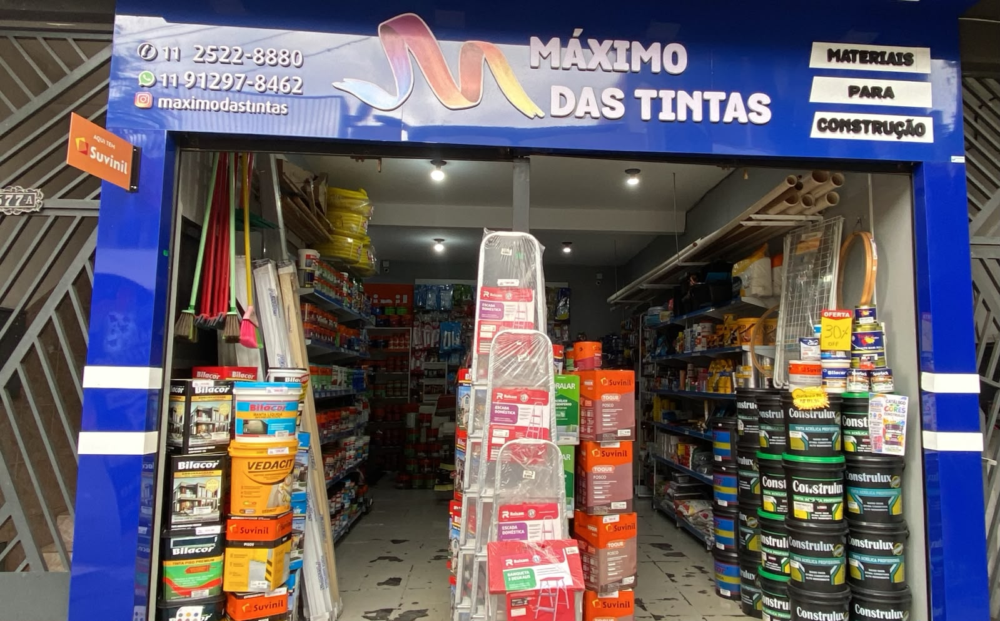 | 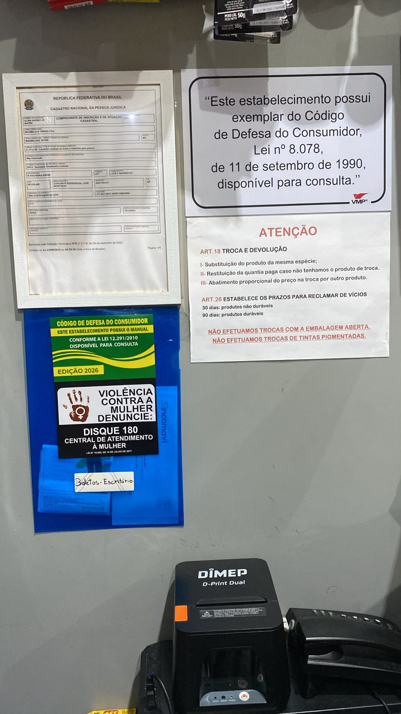 |

| Ficha de produto: tinta (custo, % à vista, validade, estoque mínimo) | Ficha de produto: elétrica (item pequeno, margem de 96%) |
|---|---|
| 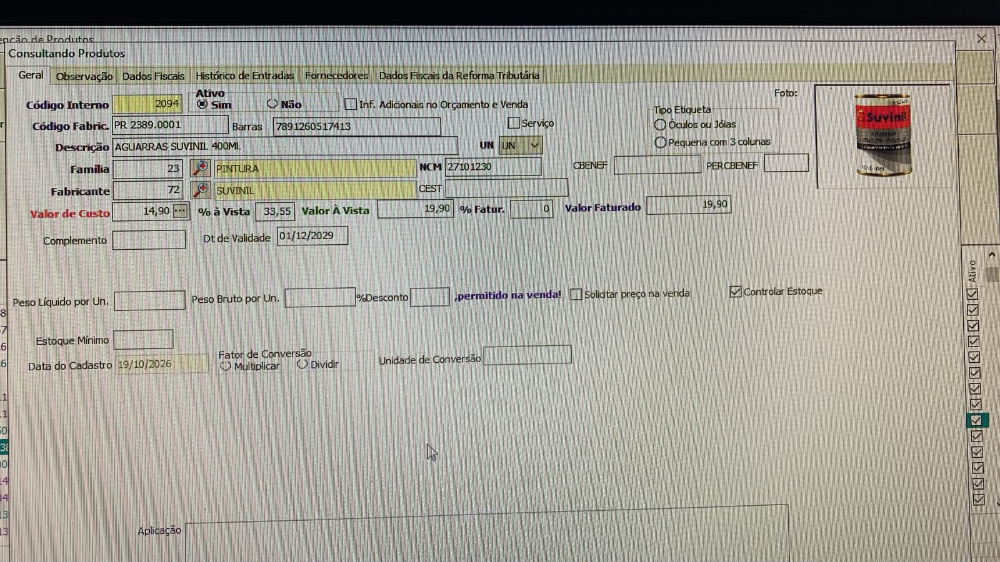 | 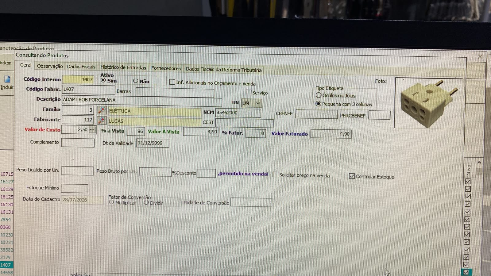 |

| Tela de venda do PDV (Venda/Orçamento, cliente BALCAO) | Cadastro de produtos (família, fabricante, custo) |
|---|---|
| 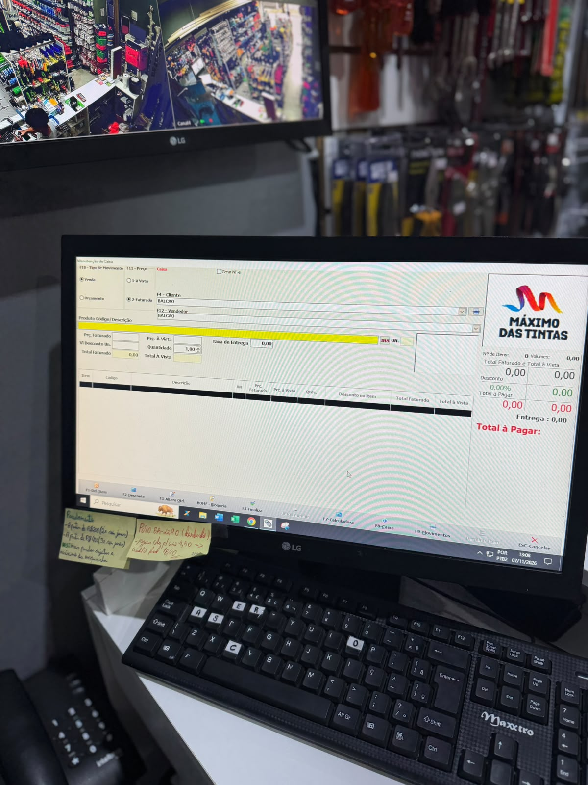 | 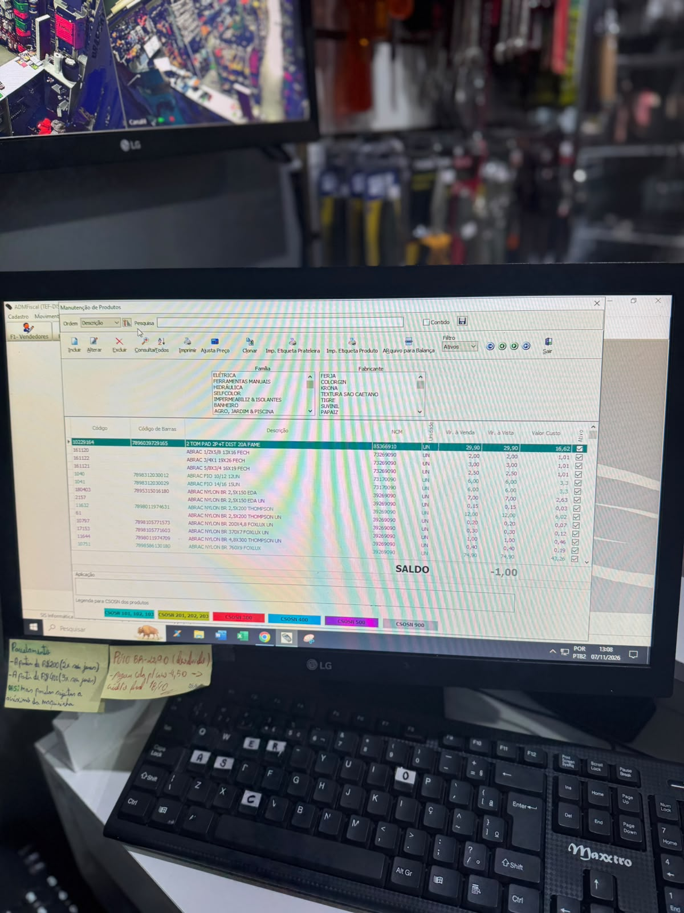 |

| Balcão de atendimento | Visita à loja (Ítalo Leal Oliveira) |
|---|---|
| 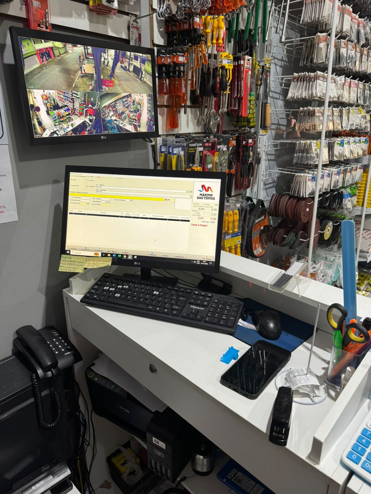 |  |

| Fachada com totem | MySQL Workbench 8.0 (instância local de um integrante) |
|---|---|
| 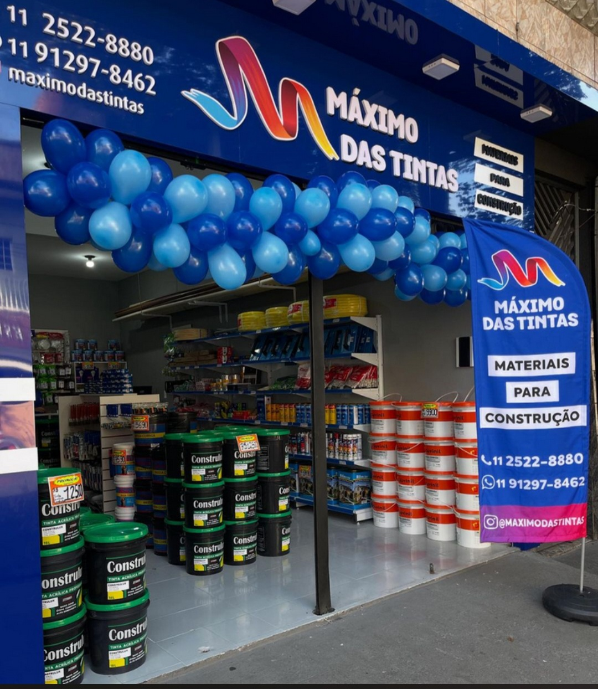 | 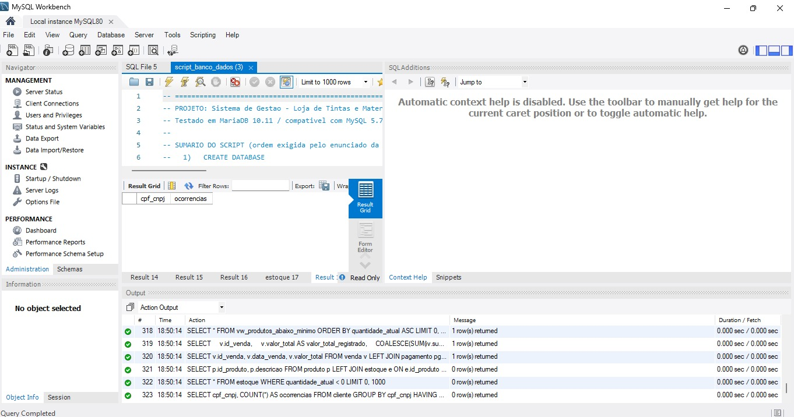 |

#### Relato da entrevista

Resumo do levantamento (o texto completo, com o que foi **dito** separado do que foi **observado**, está em [levantamento/levantamento.md](levantamento/levantamento.md)):

- **Quem / quando / onde:** entrevistada **Larissa** (Financeiro / Ajudas gerais); integrante presente: **Ítalo Leal Oliveira**; **07/11/2026**, por volta de 13h, no balcão da loja (data e hora no relógio do PDV nas fotos).
- **Dito pela entrevistada:** 2 funcionários + 1 intermediário com funções compartilhadas (venda, atendimento, cadastro, tinta na máquina, pedidos, limpeza); R$ 300–500 por dia; 100–120 produtos por mês; vendas no sistema próprio; revisão diária do que está acabando e compra pelo carrinho do site dos fornecedores, decidida com o escritório; PIX com 5% de desconto, débito, crédito, dinheiro e boleto a prazo para obras parceiras; preço pelo sistema com margem sobre o custo (corrigida depois pelo grupo com a loja: 45% tintas, 65% maioria, acima de 100% itens pequenos) + reajuste; não entrega; caixa contado na abertura e no fechamento; nada em papel. Relatórios desejados: **aumento de preço dos produtos** e **desconto dos fornecedores**.
- **Observado no local:** a tela de venda tem **Venda/Orçamento**, cliente padrão **"BALCAO"**, vendedor, preço faturado × à vista, desconto e "Gerar NF-e"; o cadastro de produtos tem **família, fabricante, valor de venda, valor à vista, valor de custo** e **ativo**; um post-it no monitor traz a política de **parcelamento (2x a partir de R$ 200, 3x a partir de R$ 400)**; a **ficha do produto** tem valor de custo, "% à Vista" (a margem: 96% num adaptador de R$ 4,90 com custo de R$ 2,50), estoque mínimo, validade, "controlar estoque" e as abas **Histórico de Entradas** e **Fornecedores**; o **mural** exibe o comprovante do CNPJ, o aviso do CDC e a política de **troca e devolução**. Orçamento, custo e parcelamento não foram citados na fala, mas estão no sistema — por isso entraram no modelo.
- **O que mudou em relação à Entrega 1:** faturamento (≈ R$ 20 mil → ≈ R$ 10 mil/mês), produtos por mês (≈ 500 → 100–120), equipe (+1 intermediário) e formação de preço; a massa de dados e as metas foram recalibradas (tabela completa no [levantamento, seção 7](levantamento/levantamento.md#7-o-que-mudou-em-relação-à-entrega-1)).

#### Processos de negócio

| Código | Processo | Dados envolvidos |
|---|---|---|
| PR1 | **Cadastro de produto** — o gerente inclui o item do catálogo | código interno do PDV, código de barras (EAN), descrição, NCM, unidade de medida, preço de venda, categoria, fornecedor principal, ativo |
| PR2 | **Cadastro de cliente** (opcional no balcão) | nome/razão social, tipo de pessoa (PF/PJ), CPF ou CNPJ, telefone, e-mail, endereço, data de cadastro; sem cadastro, a venda usa o cliente "Consumidor final" |
| PR3 | **Orçamento** — o vendedor monta os itens e o cliente decide depois | cliente, funcionário, data, status ORCAMENTO, itens (produto, quantidade, preço praticado), total; não baixa estoque nem gera pagamento |
| PR4 | **Venda de balcão** — abertura, itens, fechamento | cliente, funcionário, data/hora, status CONCLUIDA, por item: produto, quantidade, preço praticado, subtotal; total da venda |
| PR5 | **Recebimento** | por pagamento: forma (dinheiro, PIX, cartão de crédito, cartão de débito, boleto), valor, data, parcelas; **desconto de 5% no PIX** gravado na venda; crédito em 2x a partir de R$ 200 e 3x a partir de R$ 400; boleto a prazo só para obras parceiras; uma venda pode ter mais de um pagamento |
| PR6 | **Baixa e controle de estoque** | saldo atual, estoque mínimo, localização no depósito; baixa automática na venda concluída |
| PR7 | **Troca/devolução** (CDC art. 18: substituição, devolução do valor ou abatimento; vício em até 30/90 dias; sem troca de embalagem aberta ou tinta pigmentada) | venda passa a CANCELADA, o estoque dos itens volta; a venda não é apagada |
| PR8 | **Reposição** — revisão diária do que está acabando; o pedido é montado no carrinho do site do fornecedor e decidido com o escritório | produtos com saldo ≤ mínimo, fornecedor, cobertura em dias; a entrada da mercadoria atualiza o saldo |
| PR9 | **Reajuste de preço** — o sistema recalcula o preço (margem + reajuste) | preço anterior, preço novo, data (gravados em historico_preco); custo do produto; vendas antigas mantêm o preço praticado |
| PR10 | **Preparo de tinta na máquina** | a tinta preparada é vendida como um produto do catálogo (a fórmula/cor fica no sistema da máquina, fora do escopo) |
| PR11 | **Abertura e fechamento de caixa** — contagem do dinheiro | pagamentos do dia por forma (G12) |

Fluxogramas: [fluxograma/fluxo_vendas.png](fluxograma/fluxo_vendas.png) (PR2–PR5, PR7) e [fluxograma/fluxo_reposicao.png](fluxograma/fluxo_reposicao.png) (PR6, PR8).

##### Processos típicos não incluídos

Levantados por pesquisa e IA (registro na seção 6) sobre lojas de materiais de construção e conferidos com o que a loja informou:

| Processo típico | Por que ficou fora |
|---|---|
| Pedido de compra e recebimento de fornecedor | Feito no carrinho do site de cada fornecedor e decidido com o escritório; o modelo cobre o ponto de reposição (G05/G06). Evolução: tabelas compra/item_compra (seção 8) |
| Entrega em obra | A loja **não faz entrega** (o campo do PDV fica zerado) |
| Desconto de fornecedor | Desejado como relatório, mas depende dos dados de compra, que ficam nos sites dos fornecedores (seção 8) |
| Fórmula da tinta preparada (tintométrico) | A máquina tem sistema próprio; no banco a tinta preparada é um produto vendido |
| Emissão de nota fiscal | Feita pelo próprio PDV ("Gerar NF-e"), fora do escopo de modelagem |
| Contas a pagar, folha e escala | Dados administrativos do escritório, fora da operação de venda/estoque |

#### Requisitos

**Requisitos funcionais**

| Código | Requisito (com os dados envolvidos) | Problema |
|---|---|---|
| RF01 | Cadastrar, consultar, atualizar e **inativar** produto com código interno, EAN, descrição, NCM, unidade, preço, categoria e fornecedor | P1 |
| RF02 | Cadastrar cliente com nome/razão social, tipo de pessoa, CPF ou CNPJ, telefone, e-mail e endereço; permitir venda sem cadastro ("Consumidor final") | P1 |
| RF03 | Registrar venda com data/hora, cliente, funcionário e status (orçamento, concluída, cancelada) | P1, P3 |
| RF04 | Lançar vários produtos na venda, com quantidade e **preço praticado** no momento | P3 |
| RF05 | Calcular o subtotal de cada item e o total da venda | P5 |
| RF06 | Baixar o estoque automaticamente ao concluir a venda e devolver ao cancelar ou excluir | P4 |
| RF07 | Registrar um ou mais pagamentos por venda, com forma, valor, data e parcelas, e o **desconto de 5% no PIX** gravado na venda | P5 |
| RF08 | Listar produtos com saldo ≤ estoque mínimo e a cobertura em dias | P2 |
| RF09 | Emitir relatórios de faturamento por mês, categoria, fornecedor, vendedor, perfil de cliente e forma de pagamento | P3, P5 |
| RF10 | Cancelar venda sem apagar o histórico | P6 |
| RF11 | Converter orçamento em venda e listar orçamentos em aberto com valor e idade | P1 |
| RF12 | Registrar entrada de mercadoria (atualizar saldo) e reajustar preços sem alterar vendas antigas | P2 |
| RF13 | Guardar automaticamente cada reajuste de preço (anterior, novo, data) e emitir o relatório de aumento de preços por período e fornecedor | P3 |
| RF14 | Guardar o custo de cada produto e calcular a margem bruta por categoria | P3 |

**Requisitos não funcionais**

| Código | Requisito |
|---|---|
| RNF01 | **Integridade:** toda venda referencia cliente e funcionário cadastrados; regras garantidas pelo próprio banco (FK, CHECK, triggers), valendo para qualquer aplicação |
| RNF02 | **Consistência:** total = soma dos itens e pagamento = total, verificados pelas auditorias A01–A03 |
| RNF03 | **Disponibilidade:** acessível em todo o horário comercial (seg–sáb); preparado para a loja nova (o modelo aceita evoluir para estoque por loja) |
| RNF04 | **Segurança e LGPD:** CPF/CNPJ e contatos com acesso restrito por perfil (dicionário, seção 6) |
| RNF05 | **Desempenho:** consultas gerenciais em menos de 1 s com milhares de vendas (índices ix_venda_data, ix_venda_status_data) |
| RNF06 | **Usabilidade:** venda de balcão em poucos passos, sem exigir cadastro do cliente |

**Requisitos típicos não incluídos:** multiloja/filiais (hoje a loja tem uma unidade; a nova loja substitui a atual ), entrega (a loja não entrega), programa de fidelidade (não existe), integração com e-commerce (não vende on-line), controle de lote/validade de tintas  (a loja não relatou controle de validade).

#### Regras de negócio

| Código | Regra | Implementação | Verificação |
|---|---|---|---|
| RN01 | Só produto cadastrado e **ativo** pode ser vendido | FK fk_item_produto + trigger trg_item_venda_before_insert | T06, T07 |
| RN02 | Item com quantidade > 0; toda venda concluída tem ao menos um item | chk_item_qtd | T01, A07 |
| RN03 | O mesmo produto não se repete na venda (aumenta-se a quantidade) | uq_item_venda_produto | T09 |
| RN04 | O preço praticado fica gravado no item; reajuste não altera vendas antigas | coluna preco_unitario_venda | UPDATE 4.1 |
| RN05 | Total da venda = soma dos subtotais dos itens − desconto | coluna gerada subtotal + chk_venda_total | A01 |
| RN06 | Venda concluída baixa o estoque; orçamento não baixa | triggers trg_item_venda_after_insert, trg_venda_after_update_status |     UPDATE 4.2 |
| RN07 | O estoque nunca fica negativo | chk_estoque_qtd | T10, A06 |
| RN08 | Cancelamento não apaga a venda e devolve o estoque | status_venda + trg_venda_after_update_status | DELETE 5.1 |
| RN09 | Venda concluída é paga integralmente, em uma ou mais formas; parcelas ≥ 1 e só no cartão de crédito; valor ≥ 0; pagamento não antes da venda | FK + chk_pagamento_valor + chk_pagamento_parcelas + ENUM | T11, T12, A02, A03, A09, A10 |
| RN10 | Orçamento não gera pagamento | — | A04 |
| RN11 | CPF/CNPJ únicos; PF com 11 dígitos, PJ com 14 | uq_cliente_doc + chk_cliente_doc + chk_fornecedor_cnpj | T03, T04, A08 |
| RN12 | Código interno do produto (PDV) é único | uq_produto_codigo | T05 |
| RN13 | Todo produto tem uma categoria, um fornecedor principal e um registro de estoque | FKs NOT NULL + uq_estoque_produto | A05 |
| RN14 | Toda venda tem cliente e funcionário; venda sem cadastro usa o "Consumidor final" | FKs NOT NULL | T08 |
| RN15 | Troca e devolução pelo CDC (art. 18): substituição do produto, devolução do valor ou abatimento; reclamação de vício em até 30 dias (não duráveis) ou 90 dias (duráveis, art. 26); **não há troca com embalagem aberta nem de tinta pigmentada** | processo (PR7) +      status_venda = CANCELADA; prazo e tipo do produto não verificados pelo banco | seção 8 |
| RN16 | Preço de venda = custo + margem: **45% nas tintas**, **65% na maioria** e **acima de 100% nos itens pequenos**, com reajuste ao preço de mercado | coluna preco_custo (o cálculo do preço fica no PDV) | G18 |
| RN17 | Produto, cliente e funcionário com histórico não são apagados — são inativados | FKs sem CASCADE + coluna ativo | T13, T14 |
| RN18 | LGPD: dados pessoais com acesso restrito, fora da camada analítica; anonimização a pedido | política de acesso | [dicionário, §6](docs/dicionario_dados.html#s6) |
| RN19 | Desconto de 5% sobre o valor bruto quando o pagamento é integralmente no PIX | coluna valor_desconto + chk_venda_desconto | T15, A11, G19 |
| RN20 | Parcelamento no crédito: 2x sem juros a partir de R$ 200 e 3x a partir de R$ 400; exceções a critério da maquininha, com **limite de 24x** | chk_pagamento_parcelas (1 a 24) + consulta de conferência | T17, A12 |
| RN21 | Todo reajuste de preço fica registrado (preço anterior, novo e data) | tabela historico_preco + trigger trg_produto_after_update_preco + chk_historico_precos | T16, A13, G17 |

**Regras típicas não incluídas:** limite de valor para obras parceiras no boleto (não relatado), desconto além dos 5% do PIX (não relatado), taxa de entrega (a loja não entrega), venda de produtos controlados (thinner/solventes não exigem registro de comprador neste porte ).

#### DER conceitual (notação do brModelo)

- **DER do grupo no brModelo Web** (22/09/2026): [entrega-1/DER_brmodelo_22-09-2026.pdf](entrega-1/DER_brmodelo_22-09-2026.pdf) — retângulos, losangos, círculos preenchidos (identificador) e vazios (atributos) e cardinalidade (mín, máx) dos dois lados.
- **DER em notação de Chen** (apoio visual, gerado com Graphviz): [entrega-1/DER_chen_loja_tintas.png](entrega-1/DER_chen_loja_tintas.png).
- **Software:** brModelo Web (DER oficial) e Graphviz (diagrama de apoio).

##### DER conceitual revisado (brModelo)

> **Imagem do DER revisado no brModelo: a adicionar** (em produção pelo grupo; será salva em docs/der_conceitual_brmodelo.png).

O DER revisado representa todos os dados da operação da loja em **9 entidades** e **8 relacionamentos**, na notação do brModelo: entidades em retângulo, relacionamentos em losango, identificador em círculo preenchido, atributos em círculo vazio e cardinalidade (mín, máx) dos dois lados. **Não há chaves estrangeiras desenhadas**: elas só aparecem no modelo lógico (seção 2).

| Entidade | Identificador | Atributos | Representa |
|---|---|---|---|
| CATEGORIA | id_categoria | nome_categoria, descricao | Família do produto no PDV (Tintas, Ferramentas Manuais...) |
| FORNECEDOR | id_fornecedor | nome_fornecedor, cnpj, telefone, email | Fabricante/marca (Suvinil, Tramontina...) |
| PRODUTO | id_produto | codigo_interno, codigo_barras, descricao, ncm, unidade_medida, preco_unitario, preco_custo, ativo | Item do catálogo do PDV |
| ESTOQUE | id_estoque | quantidade_atual, quantidade_minima, localizacao_deposito | Saldo e ponto de reposição de cada produto |
| HISTORICO_PRECO | id_historico | preco_anterior, preco_novo, data_alteracao | Cada reajuste de preço (relatório pedido pela loja) |
| CLIENTE | id_cliente | nome, tipo_pessoa, cpf_cnpj, telefone, email, endereco, data_cadastro | Consumidor, obra parceira ou "BALCAO" |
| FUNCIONARIO | id_funcionario | nome, cargo, cpf, data_admissao, ativo | Os 2 funcionários e o intermediário |
| VENDA | id_venda | data_venda, status_venda, valor_desconto, valor_total | Venda de balcão, orçamento ou venda cancelada |
| PAGAMENTO | id_pagamento | forma_pagamento, valor_pago, data_pagamento, parcelas | Recebimento da venda |

| Relacionamento | Entidades e cardinalidades | Leitura |
|---|---|---|
| classifica | CATEGORIA (1,1) — (0,n) PRODUTO | Todo produto tem uma categoria; uma categoria pode ainda não ter produtos |
| fornece | FORNECEDOR (1,1) — (0,n) PRODUTO | Todo produto tem um fornecedor principal |
| possui | PRODUTO (1,1) — (1,1) ESTOQUE | Cada produto tem exatamente um registro de estoque |
| registra | PRODUTO (1,1) — (0,n) HISTORICO_PRECO | Um produto acumula zero ou mais reajustes |
| realiza | CLIENTE (1,1) — (0,n) VENDA | Toda venda tem um cliente (ou o "BALCAO"); há clientes sem compras |
| atende | FUNCIONARIO (1,1) — (0,n) VENDA | Toda venda tem um funcionário responsável |
| **contém** (entidade associativa **ITEM_VENDA**) | VENDA (0,n) — (1,n) PRODUTO, com os atributos quantidade e preco_unitario_venda | Uma venda tem um ou mais produtos; um produto aparece em zero ou mais vendas. O preço praticado fica no relacionamento, não no produto |
| gera | VENDA (1,1) — (0,n) PAGAMENTO | Orçamento não tem pagamento; venda concluída tem um ou mais (ex.: dinheiro + PIX) |

Atributo derivado: subtotal (quantidade × preço praticado) e o total da venda (soma dos itens − desconto). Domínios fechados: tipo_pessoa (PF/PJ), status_venda (ORCAMENTO/CONCLUIDA/CANCELADA), forma_pagamento (DINHEIRO/PIX/CARTAO_CREDITO/CARTAO_DEBITO/BOLETO).

#### Revisão do modelo conceitual (Caso A)

A organização é a mesma da Entrega 1 (Caso A). **O grupo não recebeu apontamentos de correção da Entrega 1 por parte do professor**; por isso a revisão abaixo foi feita por iniciativa do grupo, a partir da implementação no MySQL, do esqueleto da Entrega 2 e da entrevista de 07/11/2026.

Mudanças feitas pelo grupo entre o DER do brModelo e o modelo implementado:

| No DER do brModelo (22/09) | No modelo final | Por quê |
|---|---|---|
| ESTOQUE ligado a CATEGORIA (1,1) | ESTOQUE ligado a **PRODUTO** (1:1) | O saldo é de cada produto, não da categoria |
| VENDEDOR com id e nome | **FUNCIONARIO** com cargo, cpf, data_admissao e ativo | Os mesmos 2 funcionários vendem, operam o caixa e repõem; ativo preserva o histórico de quem saiu |
| ENDEREÇO como entidade (1,N) de CLIENTE | Atributo endereco (texto simples) em CLIENTE | A loja não entrega (confirmado em 07/11) nem usa vários endereços; pode voltar a ser tabela (seção 8) |
| "Refere-se" ligando ITEM_VENDA, PRODUTO e CATEGORIA | CATEGORIA 1:N PRODUTO; ITEM_VENDA como **associativa** entre VENDA e PRODUTO | A categoria é do produto; o item liga venda e produto |
| Atributos id_cliente, id_funcionario, id_categoria... desenhados nas entidades | Removidos do conceitual; viram FK só no modelo lógico | FK é decisão do modelo lógico |
| nome_produto, preco_unitario | descricao, preco_unitario + codigo_interno, ncm, unidade_medida, ativo | Campos reais do PDV; ativo permite inativar (RN01, RN17) |
| VENDA com data_hora | data_venda + **status_venda** | Orçamento e cancelamento precisam de estado (PR3, PR7) |
| ITEM_VENDA com preco_unitario e subtotal | preco_unitario_venda + subtotal como coluna gerada | Preço histórico (RN04); subtotal nunca diverge (RN05) |
| PAGAMENTO com forma_pagamento, valor_pago | + data_pagamento, parcelas; forma como domínio fechado | Parcelamento e conferência por data (RN09) |
| CLIENTE com cpf_cnpj | + tipo_pessoa e cliente "Consumidor final" | PF e PJ (RN11); venda sem cadastro (RN14) |
| FORNECEDOR com endereco | Sem endereço (decisão do grupo) | Não é usado em nenhum processo; o contato com o fornecedor é pelo site dele |
| (após a entrevista de 07/11) PRODUTO sem custo | + preco_custo | O sistema da loja guarda o custo; permite a margem (RN16, G18) |
| (após a entrevista) VENDA sem desconto | + valor_desconto | Desconto de 5% no PIX (RN19) |
| (após a entrevista) sem histórico de preço | Nova entidade **HISTORICO_PRECO** (1:N com PRODUTO) | Relatório de aumento de preços pedido pela loja (RN21, G17) |

### 1.2 Conversão do Modelo Conceitual para o Modelo Lógico

- **Entidades → tabelas:** cada uma das 9 entidades virou uma tabela (categoria, fornecedor, produto, estoque, cliente, funcionario, venda, pagamento, historico_preco) e a associativa ITEM_VENDA virou item_venda.
- **Atributos → colunas:** identificador → PK id_* INT AUTO_INCREMENT; atributo opcional → coluna que aceita NULL (codigo_barras, ncm, telefone, email, endereco, localizacao_deposito); domínio fechado → ENUM (tipo_pessoa, status_venda, forma_pagamento) ou TINYINT(1) (ativo); derivado → coluna gerada (subtotal); valores em dinheiro → DECIMAL(10,2).
- **Relacionamentos → chaves:** 1:N vira FK no lado N (inclusive PRODUTO–HISTORICO_PRECO); 1:1 (PRODUTO–ESTOQUE) vira FK com UNIQUE em estoque; N:N com atributos (VENDA × PRODUTO) vira a tabela item_venda com duas FKs e UNIQUE (id_venda, id_produto).
- **Cardinalidades:** mínima 1 → FK NOT NULL (todo produto tem categoria e fornecedor; toda venda tem cliente e funcionário); mínima 0 do lado N → nenhum registro filho obrigatório (cliente sem compras, orçamento sem pagamento).
- **Generalização/especialização:** não há no DER. Cliente PF e PJ ficou em **tabela única** com tipo_pessoa, porque os atributos são os mesmos e só o formato do documento muda (garantido por chk_cliente_doc).

Resultado: **10 tabelas**, 9 FKs, 7 UNIQUE, 11 CHECK, 3 índices extras, 8 triggers e 8 views.

### 1.3 Definição de Chaves Primárias e Estrangeiras

| Tabela | PK | FK → tabela pai | Cardinalidade (pai — filho) | Ao excluir o pai |
|---|---|---|---|---|
| categoria | id_categoria | — | | |
| fornecedor | id_fornecedor | — | | |
| produto | id_produto | id_categoria → categoria; id_fornecedor → fornecedor | (1,1) — (0,N) | bloqueia |
| estoque | id_estoque | id_produto → produto (UNIQUE) | (1,1) — (1,1) | bloqueia |
| cliente | id_cliente | — | | |
| funcionario | id_funcionario | — | | |
| venda | id_venda | id_cliente → cliente; id_funcionario → funcionario | (1,1) — (0,N) | bloqueia |
| item_venda | id_item_venda | id_venda → venda; id_produto → produto | (1,1) — (1,N) / (1,1) — (0,N) | venda: **CASCADE**; produto: bloqueia |
| pagamento | id_pagamento | id_venda → venda | (1,1) — (0,N) | bloqueia |
| historico_preco | id_historico | id_produto → produto | (1,1) — (0,N) | bloqueia |

Chaves candidatas mantidas como UNIQUE: produto.codigo_interno, cliente.cpf_cnpj, fornecedor.cnpj, funcionario.cpf, categoria.nome_categoria, estoque.id_produto, item_venda (id_venda, id_produto).

### 1.4 Processo de Normalização (1FN, 2FN e 3FN)

- **1FN** — eliminar grupos repetitivos e multivalorados. Na lista do PDV, uma venda traz vários produtos e pode ter vários pagamentos: colocar "produto1, produto2..." ou "forma1, forma2" na venda criaria grupos repetitivos. Por isso itens foram para item_venda e pagamentos para pagamento. ENDEREÇO, que no brModelo era multivalorado (1,N), ficou como um único texto por cliente, porque a loja não entrega nem usa mais de um endereço (decisão do grupo). Todas as colunas são atômicas e toda tabela tem PK.
- **2FN** — eliminar dependências parciais. Em item_venda, a chave candidata é (id_venda, id_produto). A descrição e o preço vigente dependem só de id_produto (dependência parcial) e por isso ficam em produto; em item_venda ficam só quantidade e preco_unitario_venda, que dependem do par inteiro. As demais tabelas têm PK simples.
- **3FN** — eliminar dependências transitivas. Em uma "planilha de vendas" única, nome_categoria e nome_fornecedor dependeriam de id_produto, que depende da venda (venda → produto → categoria): o nome da categoria seria repetido em centenas de linhas e um erro de digitação quebraria o relatório por categoria (P3). Por isso categoria e fornecedor são tabelas próprias, o nome do cliente e do vendedor não se repetem em venda, e o saldo fica em estoque, não em produto.
- **Por que cada forma foi necessária aqui:** a 1FN permite registrar vendas com vários itens e pagamento dividido (13 vendas da massa pagam em duas formas); a 2FN permite reajustar o preço do produto sem alterar o histórico (RN04, UPDATE 4.1); a 3FN dá relatórios por categoria/fornecedor/vendedor sem inconsistência (G07, G08, G09).

**Redundâncias deliberadas e proteção:**

| Redundância | Por quê | Proteção |
|---|---|---|
| `item_venda.preco_unitario_venda` | Preço praticado não muda com o reajuste (as tintas vendidas antes de abril/2026 mantêm o preço antigo) | Gravado na venda (RN04) |
| `item_venda.subtotal` | Relatórios mais simples | Coluna gerada pelo MySQL: não diverge |
| `venda.valor_total` | Total instantâneo no balcão | Auditoria A01 |
| `estoque.quantidade_atual` | Saldo instantâneo | Só triggers alteram na venda; `CHECK >= 0`; A06 |
| `historico_preco.preco_novo` | Preço atual também está em `produto` | Gravado pelo trigger; auditoria A13 compara com o preço atual |

### 1.5 Justificativas Técnicas das Decisões

| Decisão | Justificativa | RN |
|---|---|---|
| **PK substituta** (`INT AUTO_INCREMENT`) em todas as tabelas | Código do PDV, CPF/CNPJ e nomes podem ser digitados errado ou mudar; um número interno estável evita atualizar FKs. As chaves naturais ficam `UNIQUE` | RN11, RN12 |
| **FKs `NOT NULL`** em produto e venda | Todo produto tem categoria e fornecedor; toda venda tem cliente e funcionário | RN13, RN14 |
| **`ON DELETE CASCADE` só em `item_venda → venda`** | O item não existe sem a venda; pagamento e cadastros nunca somem em cascata | RN17 |
| **ESTOQUE separado de PRODUTO (1:1)** | Separa o dado que muda a cada venda do cadastro; permite evoluir para estoque por depósito | RN13 |
| **`item_venda` associativa + `UNIQUE (id_venda, id_produto)`** | Resolve o N:N, guarda o preço praticado e impede produto repetido | RN03, RN04 |
| **`status_venda` em vez de apagar** | Orçamento, venda e cancelamento no mesmo registro, com histórico | RN06, RN08, RN10 |
| **Cliente "Consumidor final"** | Boa parte das vendas de balcão é feita sem cadastro; evita FK nula e dados pessoais desnecessários (minimização da LGPD) | RN14, RN18 |
| **`CHECK`** de valores (preço, quantidade, saldo, total, valor pago, parcelas de 1 a 24) e de formato (CPF/CNPJ) | Bloqueiam valores impossíveis na origem | RN02, RN07, RN09, RN11 |
| **`ENUM`** em `tipo_pessoa`, `status_venda`, `forma_pagamento` | Só os valores previstos no dicionário | RN09 |
| **Triggers** (8: estoque, RN01 e histórico de preço; criados antes da carga) | A regra vale para qualquer aplicação; a própria massa passa pela baixa automática; a variável `@venda_em_exclusao` evita devolução em dobro no `DELETE` em cascata | RN01, RN06, RN08 |
| **`valor_desconto` na venda** (e não no pagamento) | O desconto muda o total devido; assim o total continua igual a itens − desconto e os pagamentos fecham o total | RN05, RN19 |
| **`historico_preco` preenchida por trigger** | Nenhum reajuste escapa do relatório, venha do PDV ou de um `UPDATE` direto | RN21 |
| **`preco_custo` opcional** | Nem todo item antigo tem custo cadastrado; a margem só usa produtos com custo | RN16 |
| **Índices** `ix_venda_data`, `ix_venda_status_data` e `ix_historico_data` | Consultas gerenciais por período e status | RNF05 |
| **`DECIMAL(10,2)`** | Dinheiro sem erro de arredondamento | RN05, RN09 |
| **MySQL 8.0.16+** | SGBD da disciplina; `CHECK` só é aplicada a partir do 8.0.16 e `DEFAULT (CURRENT_DATE)` exige 8.0.13 | — |

### 1.6 Proposta de Arquitetura Analítica para BI e IA

```
PDV / balcão ──► MySQL (OLTP, 10 tabelas, triggers de estoque e de preço)
                     │  views (somente leitura) / exportação periódica
                     ▼
          Camada analítica (8 views + consultas G01–G19)
                     │
        ┌────────────┴─────────────┐
        ▼                          ▼
  Painéis de BI (gerência)    Modelos de IA (demanda, reposição)
```

**Informações estratégicas:** quanto a loja fatura e com quais produtos (curva ABC), quais marcas sustentam a receita (negociação com fornecedor), quando falta mercadoria, quem compra (balcão, PF, PJ), em que dias e horários a loja precisa dos dois funcionários, quanto dinheiro está parado em estoque.

**KPIs** (cada um com consulta no script):

| KPI | Fórmula | Período | Meta | Consulta | Na massa (jan–jun/2026) |
|---|---|---|---|---|---|
| KPI1 Faturamento | Σ `valor_total` das vendas concluídas | mensal | R$ 10.000 (R$ 300–500/dia, informado) | G01 | R$ 6,8 mil a R$ 13,3 mil; média R$ 10,1 mil (≈ R$ 410 por dia de venda) |
| KPI2 Ticket médio | faturamento ÷ nº de vendas concluídas | mensal | ≥ R$ 130 (meta do grupo) | G02 | R$ 103 a R$ 168; média R$ 138 |
| KPI3 Unidades vendidas | Σ `quantidade` dos itens de vendas concluídas | mensal | 100–120 (informado) | G03 | média 104 |
| KPI4 Taxa de cancelamento | canceladas ÷ (concluídas + canceladas) | mensal | ≤ 5% | G04 | 1,6% a 6,4% (jan e mar acima da meta) |
| KPI5 Produtos abaixo do mínimo | nº de produtos com saldo ≤ mínimo | diário | 0 | G05 | 7 na carga |
| KPI6 Cobertura de estoque | saldo ÷ média diária vendida (90 dias) | diário | ≥ 15 dias (meta do grupo) | G06 | lista os 15 piores |
| KPI7 Desempenho por vendedor | faturamento e ticket por funcionário | mensal | — | G09 | |
| KPI8 Concentração da receita (ABC) | % acumulado da receita por produto | semestral | — | G10 | 5 produtos (tintas) fazem quase 80% |
| KPI9 Formas de pagamento | % do valor por forma | mensal | — | G11 | PIX 38%, crédito 20%, débito 19%, dinheiro 14%, boleto 10% |
| KPI10 Perfil de cliente | % do faturamento por perfil | mensal | — | G14 | balcão 61%, PF cadastrada 24%, obras/PJ 15% |
| KPI11 Vendas por dia/turno | nº de vendas por dia da semana e turno | semanal | — | G15 | |
| KPI12 Valor do estoque | Σ saldo × preço de venda | mensal | — | G16 | |
| KPI13 Reajuste de preço | (preço novo − anterior) ÷ anterior, por produto | mensal | — (relatório pedido pela loja) | G17 | tintas +5% em abril/2026 |
| KPI14 Margem sobre o custo | (receita − custo) ÷ custo, por categoria (também mostra a margem bruta) | mensal | 45% tintas · 65% maioria · >100% itens pequenos (informado) | G18 | ≈ 42% nas tintas (vendas antes do reajuste de abril puxam para baixo), ≈ 66% nas demais categorias e 140% no item pequeno de instrumentos |
| KPI15 Desconto PIX sobre o bruto | Σ desconto ÷ faturamento bruto | mensal | — | G19 | 0,9% a 2,4% |

**Rastreabilidade — problema ou KPI → tabelas → consulta:**

| Problema ou KPI | Tabelas envolvidas | Consulta no script |
|---|---|---|
| P1 base única, orçamentos e visão do estoque | VENDA, CLIENTE, ESTOQUE, PRODUTO, CATEGORIA | G13, G14, G16 |
| P2 ponto de reposição | ESTOQUE, PRODUTO, FORNECEDOR, ITEM_VENDA | G05, G06, G10 |
| P3 relatórios gerenciais e aumento de preço | VENDA, ITEM_VENDA, PRODUTO, CATEGORIA, FORNECEDOR, FUNCIONARIO, HISTORICO_PRECO | G01, G02, G07, G08, G09, G15, G17, G18 |
| P4 baixa automática de estoque | ITEM_VENDA, VENDA, ESTOQUE | G03, G06, A06 |
| P5 conferência do caixa e dos descontos | PAGAMENTO, VENDA, ITEM_VENDA | G11, G12, G19, A01, A02, A03, A11 |
| P6 cancelamentos sem perder histórico | VENDA | G04 |
| KPI1 a KPI15 | ver tabela de KPIs | G01–G19 |

**Potencial para BI:** uma ferramenta de BI (Power BI, Metabase, Looker Studio) ligada às 8 views e às consultas G01–G19 entrega um painel com faturamento × meta, ticket médio, curva ABC, alerta de reposição, formas de pagamento e desempenho por vendedor. O modelo já é praticamente um esquema estrela: fatos em `item_venda` e `pagamento`; dimensões tempo (`data_venda`), produto/categoria/fornecedor, funcionário e cliente.

**Aplicações de IA** (propostas): (1) **previsão de demanda** por produto e mês sobre `item_venda` (tintas têm sazonalidade: verão e fim de ano); (2) **reposição sugerida**, em que G05/G06 são a versão em SQL e um modelo ajusta o estoque mínimo pelo giro real — e já monta a lista para o carrinho do fornecedor; (5) **apoio à abertura da loja nova**: o histórico de vendas por produto e categoria orienta o mix e o estoque inicial; (3) **produtos comprados juntos** (regras de associação sobre `item_venda`: tinta + rolo + fita + lixa) para sugerir itens no balcão; (4) **detecção de anomalias** em cancelamentos e diferenças de caixa (G04, A01–A03).

**Cuidados:** CPF/CNPJ, telefone, e-mail e endereço ficam fora da camada analítica (LGPD, RN18). A massa é 100% fictícia.

---

## 2. Modelo Lógico Relacional

> **Imagem do modelo lógico no brModelo: a adicionar** (em produção pelo grupo; será salva em `docs/modelo_logico_brmodelo.png`). Enquanto isso, segue o diagrama gerado do banco real, com o mesmo conteúdo.

**O que o modelo lógico mostra:** as **10 tabelas** do banco `loja_tintas_materiais` — as 9 entidades do DER mais a tabela associativa `item_venda`, que resolve o N:N entre VENDA e PRODUTO —, cada coluna com seu tipo de dado, as **chaves primárias** (PK) e as **9 chaves estrangeiras** (FK) com a cardinalidade (mín, máx) nas duas pontas. Leitura rápida:

- **Catálogo** (azul): `categoria` e `fornecedor` → `produto` (1:N); `produto` → `estoque` (1:1, FK única) e → `historico_preco` (1:N).
- **Pessoas** (verde): `cliente` e `funcionario` → `venda` (1:N).
- **Transação** (laranja): `venda` → `item_venda` ← `produto` (associativa, com quantidade e preço praticado) e `venda` → `pagamento` (1:N).

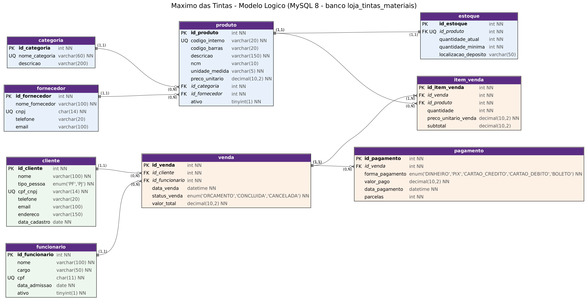

- **Tabelas, colunas com tipo, PK, FK e cardinalidade (mín, máx) em cada ponta.** Gerado com **Graphviz** a partir do catálogo do MySQL real (`scripts/gerar_docs_banco.py`), então reflete exatamente o banco. Versão vetorial: [`docs/modelo_logico.svg`](docs/modelo_logico.svg).
- O esqueleto pede a **notação visual do brModelo**; a versão no brModelo Web (mesmas tabelas, tipos, PK/FK e cardinalidades) está sendo produzida pelo grupo e entrará acima.
- As demais restrições (`NOT NULL`, `UNIQUE`, `CHECK`, `DEFAULT`) estão no **dicionário de dados**: [`docs/dicionario_dados.html`](docs/dicionario_dados.html), no modelo do `02-03g_Exemplo_Dicionario_Dados.pdf` (modelo conceitual, fluxo de dados, convenções, notação formal por entidade, índices, log de acesso e acesso por operação/LGPD).

## 3. Script SQL Completo

O script único é [`docs/script.sql`](docs/script.sql), na ordem exigida, montado por [`docs/build_script.sh`](docs/build_script.sh) a partir dos arquivos numerados:

| Arquivo | Conteúdo (ordem do esqueleto) |
|---|---|
| `01_create_database.sql` | 1. `CREATE DATABASE` |
| `02_create_tables.sql` | 2–3. `CREATE TABLE` com PK, FK, `NOT NULL`, `UNIQUE`, `CHECK`, `ENUM`, `DEFAULT`, coluna gerada e índices |
| `03_triggers_views.sql` | 8 triggers (estoque, RN01 e histórico de preço) e 8 views — criados antes da carga para a massa passar pelas regras |
| `04_massa_de_dados.sql` | 4. `INSERT INTO` (gerado por `scripts/gerar_massa.py`) |
| `05_select_join.sql` | 5. `SELECT` com `JOIN` (S01–S05) |
| `06_update_delete.sql` | 6–7. `UPDATE` (reajuste, orçamento → venda, cadastro, reposição) e `DELETE` (cancelamento, item de orçamento, venda duplicada com devolução de estoque, funcionário, demonstração da auditoria com `ROLLBACK`) |
| `07_consultas_gerenciais.sql` | 8. **G01–G19**, cada uma com código, pergunta e problema/KPI atendido |
| `08_consultas_auditoria.sql` | 9. **A01–A13**, cada uma com código, pergunta e `Verifica: RNxx` |
| `09_testes_restricoes.sql` | 17 operações inválidas que o banco deve rejeitar (fora do script único; rodar com `--force`) |

Exemplo de cabeçalho usado:

```sql
-- G05 — Quais produtos estao no ponto de reposicao agora?
-- Atende: KPI5 Produtos abaixo do minimo (meta: 0) · P2

-- A03 — Existe venda concluida cuja soma dos pagamentos difere do total?
-- Verifica: RN09 (pagamento integral, em uma ou mais formas)
```

Como executar:

```bash
mysql -u root -p --default-character-set=utf8mb4 < docs/script.sql
```

```bash
mysql -u root -p --force loja_tintas_materiais < docs/09_testes_restricoes.sql
```

**Testes (10/11/2026, MySQL 8.0.46, banco vazio):** script executado do início ao fim **sem erros (exit 0)**; auditoria **A01–A13 com 0 violações** na carga e após os `UPDATE`/`DELETE`; **17 de 17** operações inválidas rejeitadas (quantidade zero, preço negativo, CPF duplicado, CPF com formato errado, código interno duplicado, produto inexistente, produto inativo, cliente inexistente, produto repetido na venda, venda maior que o estoque, parcelas = 0, forma de pagamento inválida, exclusão de produto e de cliente com histórico, desconto negativo, "reajuste" com o mesmo preço, parcelamento acima de 24x).

**Execução no MySQL Workbench:** um integrante também executou o script no **MySQL Workbench 8.0** (instância local MySQL80), sem erros — ver [`evidencias/mysql_workbench_execucao_script.jpg`](evidencias/mysql_workbench_execucao_script.jpg) e [`evidencias/mysql_workbench_versao.jpg`](evidencias/mysql_workbench_versao.jpg). *(Os prints são da versão anterior do script; a versão atual foi testada no MySQL 8.0.46.)* A seção 5.5 do `06` mostra a auditoria A01 encontrando uma divergência provocada dentro de uma transação desfeita com `ROLLBACK`.

## 4. Massa de Dados

Arquivo: [`docs/04_massa_de_dados.sql`](docs/04_massa_de_dados.sql), gerado por [`scripts/gerar_massa.py`](scripts/gerar_massa.py) (Python, semente fixa: a mesma saída a cada execução). **Nenhum dado pessoal real**: nomes, CPFs, CNPJs, telefones e e-mails são inventados. Os 67 produtos (código, EAN, NCM, descrição) são os reais das listas do PDV. O volume foi calibrado pelos números da entrevista de 07/11/2026.

**Como o porte real justifica o volume de cada tabela** (período simulado: jan–jun/2026, segunda a sábado):

| Tabela | Linhas | Justificativa |
|---|---|---|
| categoria | 5 | Categorias das listas do PDV |
| fornecedor | 10 | Marcas reais das listas (contatos fictícios) |
| produto | 67 | Itens reais das listas de preço; custo **estimado pela margem informada** (45% tintas, 65% maioria, >100% itens pequenos); 2 inativados no fim do período |
| estoque | 67 | 1 por produto; 7 terminam no ponto de reposição |
| funcionario | 3 | Os **2 funcionários + 1 intermediário** da loja (nomes fictícios) |
| cliente | 121 | "Consumidor final" (o "BALCAO" do PDV) + 95 PF + 25 PJ (obras parceiras); 29 sem compras no período |
| venda | 467 | ≈ 78 vendas/mês (436 concluídas, 18 canceladas, 13 orçamentos); ticket médio R$ 138 → **≈ R$ 10,1 mil/mês, ≈ R$ 410 por dia de venda** (real: R$ 300–500/dia) |
| item_venda | 580 | ≈ 1,25 item por venda → **≈ 104 unidades/mês** (real: 100–120) |
| pagamento | 449 | 1 por venda concluída; 189 no PIX com 5% de desconto; 13 vendas pagas em duas formas; 10 parcelamentos dentro da política; boleto só para obras parceiras (PJ) |
| historico_preco | 7 (+ os do `UPDATE` 4.1) | Reajuste de 5% das tintas em 01/04/2026 |

**Variedade para os testes:** vendas canceladas (1,6–6,4% ao mês), desconto no PIX, orçamentos em aberto, clientes sem compras, produtos abaixo do mínimo e zerados, 5 formas de pagamento, pagamento dividido, parcelamento, boleto com vencimento posterior, reajuste de 5% nas tintas em 01/04 (vendas antigas mantêm o preço antigo), produtos inativos com histórico, variação mensal (fevereiro mais fraco, junho mais forte).

**Coerência:** o estoque inicial é calculado para que nenhum saldo fique negativo depois das baixas automáticas; todo total bate com os itens e todo pagamento com o total — a auditoria A01–A10 retorna 0 violações.

## 5. Repositório GitHub

```text
Banco-de-dados-3feira/
├── README.md                      ← relatório técnico (Entrega 2 + Anexo A com a Entrega 1)
├── levantamento/levantamento.md   ← levantamento da entrevista (o grupo completa)
├── evidencias/                    ← fotos JPG da visita (balcão/PDV, loja)
├── docs/                          ← script.sql, 01..09, build_script.sh,
│                                    modelo lógico (.png/.svg/.dot), dicionario_dados.html
├── entrega-1/                     ← DER no brModelo (PDF), DER em Chen (PNG), dicionário conceitual (HTML)
├── fluxograma/                    ← fluxos de venda e de reposição (.dot/.png/.svg)
└── scripts/                       ← gerar_massa.py, gerar_docs_banco.py, gerar_dicionario.py
```

**Commits:** o histórico deve ser **equilibrado entre os 4 integrantes**, cada um com a **própria conta do GitHub** e nome compatível com a tabela de integrantes. Evitar um único commit final.

**Responsabilidades:** `[PREENCHER]` (ex.: visita e levantamento; DER no brModelo; script SQL; documentação; pitch e vídeo).

## 6. Uso de Inteligência Artificial

| Item | Registro |
|---|---|
| **Ferramentas e etapas** | **ChatGPT** (Entrega 1: apoio na construção do banco e alteração de dados). **Claude (Anthropic)**: script SQL inicial e esqueletos da documentação (Entrega 1); na Entrega 2: reorganização do repositório no padrão do esqueleto, testes no MySQL 8.0.46, gerador da massa de dados, consultas G01–G16 e A01–A10, códigos RN, dicionário no modelo 02-03g, diagrama do modelo lógico, fluxogramas, levantamento de processos/requisitos/regras/KPIs típicos de lojas de materiais de construção e redação deste relatório |
| **Motivação** | Organizar o trabalho no padrão do esqueleto, testar o script de verdade no MySQL, gerar uma massa coerente com o porte real e conferir o atendimento a cada item da Entrega 2 |
| **Prompts utilizados** | "gostaria que você pudesse me fazer uma atualização geral de como está esse projeto referente a aula de banco de dados. Gostaria que você utilizasse esse projeto como base de organização e apresentação [repositório de referência], não quero que copie o tema"; "Coloque mais um integrante nos membros"; "você consegue acessar o drive agora?" (material da disciplina); "Sim, por gentileza" (aplicar os ajustes do esqueleto); "Poderia adicionar essas perguntas que estavam pendentes? [respostas da entrevista] Poderia adicionar algumas fotos pendentes também" (incorporar a entrevista de 07/11). O prompt da Entrega 1 está no [Anexo A, seção 9](#9-uso-de-inteligência-artificial) |
| **Resposta recebida (resumo)** | Reorganização do repositório; script dividido em arquivos e testado; lista do que faltava em relação ao esqueleto (códigos G/A e RN, KPIs com meta, levantamento, responsável, volume da massa, notação brModelo, dicionário no modelo 02-03g); geração dos artefatos correspondentes |
| **Fontes consultadas e verificadas** | Esqueleto e enunciado da Entrega 2, modelo de dicionário 02-03g e links da disciplina (Drive do professor); números da loja (informados pelo grupo); execução real do script no MySQL 8.0.46 |
| **Trechos rejeitados ou corrigidos** | O cabeçalho do script dizia "testado em MariaDB": refeito e documentado em MySQL 8.0.46. O `FLUXOGRAMA.pdf` era o DER do brModelo e foi renomeado. A primeira massa (20 vendas) não refletia o porte: substituída por uma massa calibrada (≈ R$ 18,9 mil e ≈ 536 unidades/mês). A primeira calibração gerou ≈ 700 unidades e R$ 14 mil/mês (produtos baratos demais), e a seguinte R$ 26 mil/mês; os pesos foram ajustados até chegar perto dos números reais. Depois da entrevista de 07/11 a margem de 3,6% anotada foi corrigida pelo grupo com a loja (45% tintas, 65% maioria, >100% itens pequenos) e o custo da massa refeito; a massa foi recalibrada de novo (≈ R$ 18,9 mil e 536 unidades/mês → ≈ R$ 10,1 mil e 104 unidades/mês), porque os números informados mudaram; o modelo ganhou desconto PIX, custo e histórico de preços. Exemplos de `UPDATE`/`DELETE` com id fixo foram trocados por consultas, para não quebrar se a massa mudar. Dados pessoais trocados por fictícios |
| **Justificativa da escolha final** | Mantivemos no trabalho aquilo que foi testado e conferido na prática, tanto no MySQL quanto no modelo solicitado pelo professor. Fizemos ajustes para deixar o banco de dados mais próximo da realidade da loja, principalmente na parte de vendas, estoque, pagamentos e consultas. Os dados que dependiam de informações reais, como nome do responsável, detalhes da entrevista e correções da primeira entrega, ficaram pendentes, pois não seria correto inventar informações que não foram confirmadas. |
| **Reflexão crítica** | Durante o desenvolvimento do trabalho, percebemos que a inteligência artificial ajudou bastante na organização das ideias, na criação dos códigos SQL e na documentação do projeto. Porém, também entendemos que ela não sabe tudo sobre a realidade da empresa e não consegue substituir as informações obtidas durante uma visita ou entrevista.<br><br>Algumas informações precisaram ser ajustadas conforme a realidade da loja. Também descobrimos, ao executar o script no MySQL, detalhes que não seriam percebidos apenas lendo o código, como problemas nas regras de estoque, pagamentos e relacionamentos entre as tabelas. Tivemos que testar, corrigir e conferir os resultados para garantir que tudo funcionasse corretamente.<br><br>Outro ponto foi que algumas respostas da IA vieram muito genéricas quando não fornecemos detalhes suficientes sobre a empresa. Com isso, aprendemos que não basta apenas pedir para a IA criar um banco de dados: precisamos entender o problema, conferir as informações e saber justificar nossas escolhas.<br><br>No final, percebemos que a IA é uma ótima ferramenta de apoio, mas a responsabilidade pelas decisões, testes e validação do trabalho continua sendo nossa, como grupo. |

## 7. Apresentação Corporativa Final

**Vídeo do pitch (8 min, YouTube "Não listado"):** link do vídeo A Máximo Das Tintas não está na lista de seminários presenciais da turma de terça; por isso o pitch é entregue em vídeo, com o link aqui no README.

Roteiro (ordem do esqueleto, slides limpos, sem blocos de texto):

1. **Problema (1 min)** — loja com 2 funcionários + 1 intermediário, R$ 300–500/dia, sem relatório de aumento de preço e com reposição na base da revisão diária (P1–P6); foto do balcão.
2. **Solução (1 min)** — 10 tabelas integradas; regras e estoque garantidos pelo próprio banco.
3. **Modelo lógico (1,5 min)** — diagrama; o que mudou desde o DER do brModelo.
4. **SQL rodando (1,5 min)** — `script.sql` do zero; converter um orçamento e ver o estoque baixar; tentar vender além do estoque (T10) e ver o bloqueio.
5. **Consultas (1,5 min)** — G01 faturamento × meta, G05 reposição, G17 aumento de preços (pedido da loja); auditoria A01–A13 com 0 violações.
6. **BI e IA (1 min)** — KPIs e rastreabilidade; previsão de demanda e produtos comprados juntos.
7. **Benefícios (0,5 min)** — estoque confiável, relatório de reajustes, controle do desconto PIX, base pronta para a loja nova.

Defesa: cada integrante responde só às perguntas dirigidas a ele; todos presentes, com vestimenta corporativa.

## 8. Limitações e pontos a validar

1. **Correção da Entrega 1:** não houve apontamentos do professor; a revisão do modelo foi feita pelo grupo (seção 1.1).
2. **Notação brModelo:** o DER revisado e o modelo lógico no brModelo estão sendo finalizados pelo grupo.
3. **ENDEREÇO** é um texto simples em `cliente` (decisão do grupo); se no futuro a loja precisar, pode virar a tabela `endereco (id_endereco, id_cliente, logradouro, numero, bairro, cidade, cep)`.
4. **Compras e desconto de fornecedor:** o pedido é feito no site do fornecedor e não entra no banco; o relatório de desconto de fornecedor (pedido pela loja) exige tabelas `compra`/`item_compra` com preço de tabela e preço pago.
5. **Custo da massa é estimado** pela margem informada (o custo real de cada item está no sistema da loja); o banco guarda o custo, mas o cálculo do preço continua no PDV.
6. **Troca e devolução (RN15):** o prazo de 30/90 dias e a proibição de troca de embalagem aberta ou tinta pigmentada não são verificados pelo banco; evolução: `venda.data_cancelamento`, `produto.duravel` e `produto.pigmentada` com uma auditoria do prazo.
7. **Estorno:** venda cancelada depois de paga mantém o pagamento registrado; o estorno não é modelado.
8. **Entrada de mercadoria** é um `UPDATE` em `estoque`; uma tabela de movimentação daria o histórico de entradas e saídas.
9. **Parcelamento (RN20):** o limite de 24x é garantido por `CHECK`; a política de 2x/3x é conferida pela auditoria A12, e não bloqueada, porque a loja aceita exceções "a critério da maquininha".
10. **Loja nova:** se as duas lojas funcionarem ao mesmo tempo, o estoque passa a ser por loja (nova tabela `loja` e FK em `estoque` e `venda`).

## Referências da disciplina

| Tema | Link | Onde foi aplicado |
|---|---|---|
| Material da disciplina (Drive) | [Pasta do Prof. Cid Andrade](https://drive.google.com/drive/folders/1QVVdiG4LxFE7L3BSnZDFmHyakaoPX94A) | Esqueleto e enunciado da Entrega 2; modelo de dicionário 02-03g |
| Dicionário de dados | [medium.com/datapsico — Dicionário de dados](https://medium.com/datapsico/dicionario-de-dados-ac3ce726c34b) | [`docs/dicionario_dados.html`](docs/dicionario_dados.html) |
| Script SQL passo a passo (Westeros) | [cidandrade.github.io/script-sql-westeros](https://cidandrade.github.io/script-sql-westeros/#passo-2) | Ordem do `script.sql` (seção 3) |
| Conversão do DER em tabelas | [cidandrade.github.io/conversor-der-tabelas](https://cidandrade.github.io/conversor-der-tabelas/#c=lotacao&a=11&b=0n&alt=1) | Seção 1.2 |
| Cardinalidade no DER | [cidandrade.github.io/cardinalidade-der](https://cidandrade.github.io/cardinalidade-der/) | Seção 1.3 e modelo lógico |
| Normalização (conferência) | [cidandrade.github.io/normalizacao](http://cidandrade.github.io/normalizacao/#conferencia) | Seção 1.4 |

---

# Anexo A — Entrega 1 (modelo conceitual)

*Conteúdo da Entrega 1 preservado, com os campos `[PREENCHER]` já respondidos pelo grupo incorporados ao texto e os caminhos de arquivos atualizados para a nova estrutura do repositório. Os processos usam o prefixo `PR` (PR1 a PR6) para não se confundir com os problemas P1 a P6 do relatório.*

> **Atenção:** os números de porte e de preço abaixo são os informados na Entrega 1 (≈ R$ 20 mil/mês, ≈ 500 produtos/mês, custo + 60%). Foram **revistos na entrevista de 07/11/2026** (R$ 300–500/dia, 100–120 produtos/mês, margem de 45% nas tintas, 65% na maioria e acima de 100% nos itens pequenos; troca pelo CDC, sem troca de embalagem aberta ou tinta pigmentada); os valores atuais estão na [seção 1.1](#caracterização-da-organização) e no [levantamento](levantamento/levantamento.md).

**Integrantes na Entrega 1:** Gabriel Rodrigues da Silva (46885030), Gabriel Souza (46683305), Vinicius Batista Merencio (46749527) e Ítalo Leal Oliveira (47837098).

### 1. Caracterização da Organização

- **Nome e natureza da organização:** **Máximo Das Tintas** — loja de pequeno porte do varejo de **tintas, ferramentas e materiais de construção**, com fins lucrativos, que vende ao consumidor final (pessoa física) e a pequenos profissionais/empresas de reforma e construção civil (pessoa jurídica).
- **Contexto e porte:** organização comercial de pequeno porte, com **2 funcionários** (que também fazem o atendimento), **faturamento médio de R$ 20 mil por mês** e **cerca de 500 produtos saindo do estoque por mês**. Catálogo amplo de itens de giro rápido — chaves, alicates, espátulas, pincéis, rolos, fitas, solventes e tintas de marcas como Suvinil, Bilacor, Tramontina, Ferja, Tigre, Condor, Famastil e Thompson.
- **Problemas e necessidades identificados:** o controle de produtos é feito por listas de preço em PDF/planilha exportadas do sistema de frente de caixa, sem uma base relacional própria que integre catálogo, estoque, vendas, clientes e fornecedores. Isso dificulta saber rapidamente o que está abaixo do estoque mínimo, cruzar vendas por vendedor/categoria/fornecedor e gerar relatórios gerenciais sem exportar e tratar planilhas à mão. `[PREENCHER]` problemas relatados pelo responsável durante a visita.
- **Justificativa da escolha:** caso real de pequeno negócio com processos de venda, controle de estoque e relacionamento com vários fornecedores — volume de dados suficiente sem a complexidade de uma rede varejista, adequado ao escopo da disciplina.
- **Evidências da organização:** [link da loja no Google](https://share.google/O58fMgnEeO1ujE6RM) · e-mail: maximosdastintas@gmail.com.

### 2. Processos de Negócio

- **Principais processos mapeados:**
  1. **PR1 — Cadastro de produtos:** inclusão de novos itens no catálogo (código interno, código de barras/EAN, descrição, NCM, unidade, preço, categoria e fornecedor).
  2. **PR2 — Cadastro de clientes:** pessoa física ou jurídica, com dados de contato.
  3. **PR3 — Controle de estoque:** entrada de mercadorias (compra ao fornecedor) e baixa automática a cada venda concluída.
  4. **PR4 — Registro de vendas:** abertura da venda, inclusão de itens (produto + quantidade), fechamento e associação ao vendedor responsável.
  5. **PR5 — Registro de pagamento:** forma de pagamento (dinheiro, PIX, cartão, boleto) e parcelamento, vinculado à venda.
  6. **PR6 — Reposição de estoque:** identificação de produtos abaixo do estoque mínimo para novo pedido ao fornecedor.
- **Fluxogramas:** [`fluxograma/fluxo_vendas.png`](fluxograma/fluxo_vendas.png) (PR2, PR4, PR5 e troca) e [`fluxograma/fluxo_reposicao.png`](fluxograma/fluxo_reposicao.png) (PR3 e PR6).

### 3. Requisitos do Sistema

#### 3.1 Requisitos Funcionais
- RF01 — O sistema deve permitir cadastrar, consultar, atualizar e inativar produtos.
- RF02 — O sistema deve permitir cadastrar clientes (pessoa física ou jurídica).
- RF03 — O sistema deve permitir registrar uma venda associada a um cliente e a um funcionário responsável.
- RF04 — O sistema deve permitir adicionar múltiplos produtos a uma mesma venda, com quantidade e preço praticado no momento da venda.
- RF05 — O sistema deve calcular automaticamente o valor total da venda a partir dos itens lançados.
- RF06 — O sistema deve dar baixa no estoque do produto ao concluir uma venda.
- RF07 — O sistema deve permitir registrar um ou mais pagamentos vinculados a uma venda.
- RF08 — O sistema deve permitir consultar produtos com estoque igual ou abaixo do mínimo definido.
- RF09 — O sistema deve permitir gerar relatórios gerenciais de faturamento por período, por categoria e por vendedor.
- RF10 — O sistema deve permitir cancelar uma venda sem apagar seu histórico (mudança de status).

#### 3.2 Requisitos Não Funcionais
- RNF01 — **Integridade:** toda venda deve referenciar um cliente e um funcionário já cadastrados (chaves estrangeiras obrigatórias).
- RNF02 — **Consistência:** o valor total da venda deve refletir a soma dos subtotais dos itens (verificável por consulta de auditoria).
- RNF03 — **Disponibilidade:** o sistema deve estar acessível durante o horário comercial da loja, sem indisponibilidades que impeçam o fechamento de vendas.
- RNF04 — **Segurança:** dados de clientes (CPF/CNPJ, contato) devem ter acesso restrito a usuários autorizados.
- RNF05 — **Desempenho:** consultas gerenciais (faturamento, ranking de produtos) devem responder em tempo aceitável mesmo com milhares de vendas.
- RNF06 — **Usabilidade:** o cadastro de uma venda deve ser possível em poucos passos, dado o ritmo de atendimento no balcão.

### 4. Regras de Negócio

- **Regras operacionais:**
  - Uma venda só pode ser registrada para um produto que exista no catálogo e esteja ativo.
  - Um item de venda não pode ter quantidade menor ou igual a zero.
  - Um produto não pode aparecer duas vezes na mesma venda como itens separados — quantidades adicionais atualizam a linha existente (restrição de unicidade `venda + produto`).
  - Um pagamento só pode ser registrado para uma venda existente; o valor pago deve ser maior ou igual a zero.
  - Toda venda concluída deve gerar baixa proporcional no estoque dos produtos vendidos.
  - O estoque de um produto não pode ficar negativo.
- **Restrições organizacionais:**
  - CPF/CNPJ de clientes e fornecedores devem ser únicos no cadastro, para evitar duplicidade.
  - Cada produto pertence a exatamente uma categoria e a um fornecedor principal, para permitir relatórios por essas dimensões.
  - **Troca:** prazo de **2 semanas**; a nota fiscal é exigida **somente para troca**.
  - **Precificação:** sobre o valor de compra do fornecedor é adicionada, em média, **60%**, que é repassado ao cliente como preço final.

### 5. Dicionário de Dados Conceitual (Preliminar)

> Versão em HTML: [`entrega-1/dicionario_dados_conceitual.html`](entrega-1/dicionario_dados_conceitual.html). A versão da Entrega 2, com tipos e restrições do MySQL, é o [dicionário de dados](docs/dicionario_dados.html).

#### Entidade: CATEGORIA
| Atributo | Descrição | Regra de negócio associada |
|---|---|---|
| id_categoria | Identificador único da categoria | Obrigatório, gerado automaticamente |
| nome_categoria | Nome da categoria de produto (ex.: "Tintas e Vernizes") | Obrigatório, único |
| descricao | Descrição complementar da categoria | Opcional |

#### Entidade: FORNECEDOR
| Atributo | Descrição | Regra de negócio associada |
|---|---|---|
| id_fornecedor | Identificador único do fornecedor | Obrigatório |
| nome_fornecedor | Razão social / marca do fornecedor (ex.: "Tramontina") | Obrigatório |
| cnpj | CNPJ do fornecedor | Obrigatório, único |
| telefone | Telefone de contato | Opcional |
| email | E-mail de contato | Opcional |

#### Entidade: PRODUTO
| Atributo | Descrição | Regra de negócio associada |
|---|---|---|
| id_produto | Identificador único interno | Obrigatório |
| codigo_interno | Código do produto usado no PDV da loja (ex.: "16642") | Obrigatório, único |
| codigo_barras | Código de barras/EAN do produto | Opcional (nem todo item possui EAN cadastrado) |
| descricao | Descrição comercial do produto (ex.: "CHV FENDA 1/8X5 AM TRAMON") | Obrigatório |
| ncm | Código NCM para fins fiscais | Opcional |
| unidade_medida | Unidade de venda (ex.: UN) | Obrigatório, padrão "UN" |
| preco_unitario | Preço de venda vigente | Obrigatório, deve ser ≥ 0 |
| id_categoria | Categoria à qual o produto pertence | Obrigatório (FK) |
| id_fornecedor | Fornecedor/marca do produto | Obrigatório (FK) |
| ativo | Indica se o produto ainda é comercializado | Obrigatório, padrão verdadeiro |

#### Entidade: ESTOQUE
| Atributo | Descrição | Regra de negócio associada |
|---|---|---|
| id_estoque | Identificador único do registro de estoque | Obrigatório |
| id_produto | Produto ao qual o estoque se refere | Obrigatório, único (1 estoque por produto) |
| quantidade_atual | Quantidade disponível em estoque | Obrigatório, não pode ser negativo |
| quantidade_minima | Quantidade mínima antes de disparar reposição | Obrigatório, padrão 5 |
| localizacao_deposito | Localização física no depósito/prateleira | Opcional |

#### Entidade: CLIENTE
| Atributo | Descrição | Regra de negócio associada |
|---|---|---|
| id_cliente | Identificador único | Obrigatório |
| nome | Nome/razão social do cliente | Obrigatório |
| tipo_pessoa | PF ou PJ | Obrigatório |
| cpf_cnpj | Documento do cliente | Obrigatório, único |
| telefone | Telefone de contato | Opcional |
| email | E-mail de contato | Opcional |
| endereco | Endereço do cliente | Opcional |
| data_cadastro | Data do primeiro cadastro | Obrigatório, gerada automaticamente |

*Exemplo fictício (não são dados reais de clientes da loja): "Marcos Aurelio Ribeiro", PF, telefone (11) 98765-4321.*

#### Entidade: FUNCIONARIO
| Atributo | Descrição | Regra de negócio associada |
|---|---|---|
| id_funcionario | Identificador único | Obrigatório |
| nome | Nome do funcionário | Obrigatório |
| cargo | Cargo (vendedor, caixa, gerente) | Obrigatório |
| cpf | CPF do funcionário | Obrigatório, único |
| data_admissao | Data de admissão | Obrigatório |
| ativo | Indica se ainda trabalha na loja | Obrigatório, padrão verdadeiro |

#### Entidade: VENDA
| Atributo | Descrição | Regra de negócio associada |
|---|---|---|
| id_venda | Identificador único da venda | Obrigatório |
| id_cliente | Cliente que realizou a compra | Obrigatório (FK) |
| id_funcionario | Funcionário que atendeu a venda | Obrigatório (FK) |
| data_venda | Data/hora da venda | Obrigatório, gerada automaticamente |
| status_venda | Orçamento, concluída ou cancelada | Obrigatório |
| valor_total | Soma dos subtotais dos itens da venda | Obrigatório, deve ser ≥ 0 |

#### Entidade: ITEM_VENDA (associativa Venda–Produto)
| Atributo | Descrição | Regra de negócio associada |
|---|---|---|
| id_item_venda | Identificador único do item | Obrigatório |
| id_venda | Venda à qual o item pertence | Obrigatório (FK) |
| id_produto | Produto vendido | Obrigatório (FK) |
| quantidade | Quantidade vendida do produto | Obrigatório, deve ser > 0 |
| preco_unitario_venda | Preço praticado no momento da venda (histórico) | Obrigatório |
| subtotal | quantidade × preco_unitario_venda | Calculado automaticamente |

#### Entidade: PAGAMENTO
| Atributo | Descrição | Regra de negócio associada |
|---|---|---|
| id_pagamento | Identificador único | Obrigatório |
| id_venda | Venda associada ao pagamento | Obrigatório (FK) |
| forma_pagamento | Dinheiro, PIX, cartão de crédito/débito ou boleto | Obrigatório |
| valor_pago | Valor pago | Obrigatório, deve ser ≥ 0 |
| data_pagamento | Data/hora do pagamento | Obrigatório |
| parcelas | Número de parcelas (cartão de crédito) | Obrigatório, deve ser ≥ 1 |

### 6. Modelagem Conceitual (Entidades, Atributos, Relacionamentos)

- **Entidades reconhecidas:** CATEGORIA, FORNECEDOR, PRODUTO, ESTOQUE, CLIENTE, FUNCIONARIO, VENDA, ITEM_VENDA (associativa) e PAGAMENTO. Cada uma representa um conceito estável do negócio: o catálogo (categoria/fornecedor/produto/estoque), as pessoas envolvidas na venda (cliente/funcionário) e a transação (venda/item_venda/pagamento).
- **Atributos e classificações:** ver o Dicionário de Dados (seção 5). Cada entidade tem um identificador substituto (`id_*`) como chave primária e um atributo natural relevante para consulta (ex.: `codigo_interno` em produto, `cpf_cnpj` em cliente) tratado como chave candidata/única.
- **Relacionamentos pertinentes:**
  - CATEGORIA (1) — (N) PRODUTO: cada produto pertence a exatamente uma categoria; uma categoria agrupa vários produtos.
  - FORNECEDOR (1) — (N) PRODUTO: cada produto é fornecido por um fornecedor principal; um fornecedor fornece vários produtos.
  - PRODUTO (1) — (1) ESTOQUE: cada produto possui exatamente um registro de controle de estoque.
  - CLIENTE (1) — (N) VENDA: um cliente pode realizar várias vendas ao longo do tempo.
  - FUNCIONARIO (1) — (N) VENDA: um funcionário atende várias vendas.
  - VENDA (N) — (N) PRODUTO, resolvido pela entidade associativa ITEM_VENDA.
  - VENDA (1) — (N) PAGAMENTO: uma venda pode ter um ou mais pagamentos (ex.: parcial + complemento).
- **Restrições e políticas aplicadas ao modelo:** unicidade de CPF/CNPJ (cliente/fornecedor/funcionário), unicidade do código interno do produto, obrigatoriedade de categoria e fornecedor para todo produto e impossibilidade de estoque ou quantidade negativa.

### 7. Diagrama Entidade-Relacionamento (DER)

**DER em notação de Chen** — entidades em retângulo, relacionamentos em losango, atributos em elipse, com as cardinalidades 1:N e 1:1 em cada ligação ([`entrega-1/DER_chen_loja_tintas.png`](entrega-1/DER_chen_loja_tintas.png)):

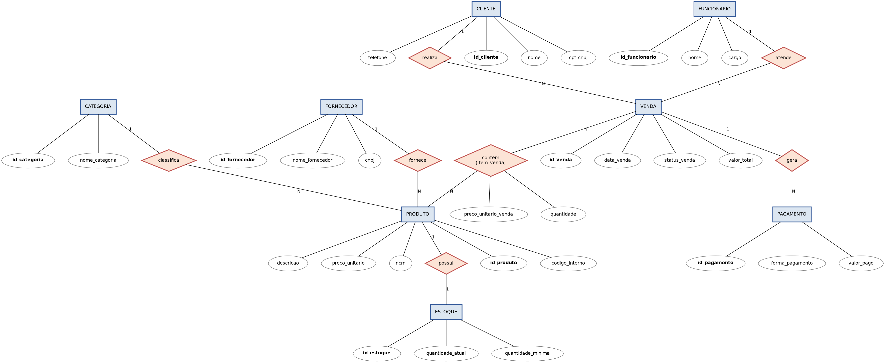

#### 7.1 DER do grupo no BRModelo (22/09/2026)

Arquivo: [`entrega-1/DER_brmodelo_22-09-2026.pdf`](entrega-1/DER_brmodelo_22-09-2026.pdf) (antes chamado `FLUXOGRAMA.pdf`). As diferenças entre este DER e o modelo final estão na [tabela de revisão da seção 1.1](#revisão-do-modelo-conceitual-caso-a).

O modelo comporta evolução futura sem quebrar a estrutura atual: histórico de reajuste de preços por produto, compras/entradas junto a fornecedores, vários endereços por cliente ou metas de vendas por funcionário.

### 8. Justificativa Técnica

- **Por que uma entidade ESTOQUE separada de PRODUTO?** Para isolar um atributo que muda com alta frequência (quantidade) do cadastro descritivo do produto (que muda raramente), deixando explícito o relacionamento 1:1, que poderá evoluir para 1:N (ex.: estoque por filial) sem afetar a tabela `produto`.
- **Por que uma entidade associativa ITEM_VENDA em vez de uma FK de produto em venda?** Porque a relação real é N:N — uma venda contém vários produtos e um produto aparece em várias vendas. A associativa também é o lugar correto do **preço praticado no momento da venda**, que não deve ser confundido com o preço atual do produto.
- **Por que separar PAGAMENTO de VENDA?** Porque uma venda pode ser paga em mais de uma transação (ex.: parte em dinheiro, parte no cartão), o que exige uma relação 1:N e não um atributo simples.
- **Por que CATEGORIA e FORNECEDOR como entidades e não como texto em PRODUTO?** Para evitar redundância (o mesmo nome repetido em centenas de produtos) e permitir relatórios agregados (faturamento por categoria, por fornecedor) sem inconsistência de digitação — motivação que antecipa a normalização da Entrega 2.
- **Por que CLIENTE e FUNCIONARIO como entidades distintas?** Porque têm ciclos de vida, atributos e regras completamente diferentes (cliente compra; funcionário vende), sem ganho em uma generalização/especialização neste escopo.
- **Alternativa considerada e descartada:** produto–fornecedor como N:N. Optou-se por 1:N porque, nos catálogos da loja, cada item está associado a uma marca/fornecedor principal; o N:N fica para uma evolução futura (ex.: cotação com vários fornecedores).

### 9. Uso de Inteligência Artificial

| Item | Registro |
|------|------------------|
| **Ferramentas e etapa** | ChatGPT e Claude, para alteração de dados e auxílio na construção do banco de dados |
| **Motivação** | `[PREENCHER]` |
| **Prompt utilizado** | "tenho um trabalho da faculdade onde preciso montar um banco de dados pretendo utilizar mysql para realizar a tarefa o meu grupo escolheu o uma loja de tintas e materiais de construção me ajude a criar o banco de dados solido plausivel e com todas as informações como um otimo banco de dados deve ser foi anexado as informações da loja tambem esta anexado o esqueleto e requisitos das entregas solicitados pelo professor me ajude criar o banco de dados e tambem os requisitos que estão sendo solicitados" |
| **Resposta recebida (resumo)** | A IA avisou que não poderia inventar a organização real nem as evidências (fotos, endereço, contato), que deveriam vir da pesquisa de campo. Gerou, a partir dos catálogos anexados: 9 tabelas (categoria, fornecedor, produto, estoque, cliente, funcionario, venda, item_venda e pagamento); o script SQL com `CREATE`, PK/FK/`UNIQUE`/`CHECK`, massa fictícia (67 produtos reais dos catálogos, 8 clientes e 5 funcionários fictícios, 18 vendas), `JOIN`, `UPDATE`, `DELETE`, consultas gerenciais e de auditoria; o DER em Chen; o modelo lógico; os esqueletos do README da Entrega 1 e do relatório da Entrega 2; e o dicionário de dados em HTML. Marcou com `[PREENCHER]` o que só o grupo poderia completar. |
| **Fontes consultadas e verificadas** | Dados e planilhas (listas de preço) do estabelecimento |
| **Trechos rejeitados ou corrigidos** | Todas as informações pessoais foram trocadas por fictícias |
| **Justificativa da escolha final** | ChatGPT e Claude foram escolhidos para auxílio em informações e resolução de problemas |
| **Reflexão crítica** | `[PREENCHER]` (ex.: "a IA não pode confirmar dados reais da loja, então todos os campos de caracterização e evidências tiveram de ser preenchidos pelo grupo após a visita") |

> O conteúdo técnico deste repositório (entidades, DER, script SQL) foi produzido com apoio de IA a partir dos catálogos de produtos fornecidos pelo grupo — isso consta aqui como uso real de IA.
