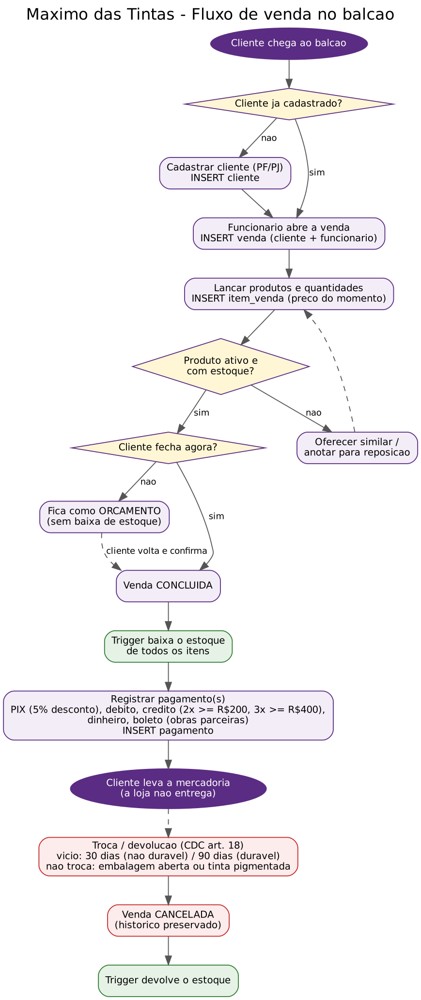
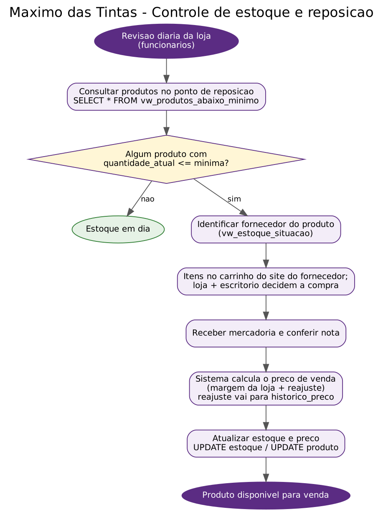

# Entrega 1 — Modelo Conceitual (DER)
### Modelagem de um sistema de gestão de informações para uma organização de pequeno porte
# Máximo Das Tintas 🫟 — Relatório Técnico Final

---
### Modelagem de Banco de Dados · Entrega 2 (modelo lógico, SQL em MySQL e arquitetura analítica)

> Este README é o relatório da Entrega 2. A Entrega 1 (caracterização, processos, requisitos, regras, dicionário conceitual e DER) está preservada no **[Anexo A](#anexo-a--entrega-1-modelo-conceitual)** no fim do arquivo.
> Marcadores: **`[PREENCHER]`** = dado que só o grupo tem · **`[VALIDAR]`** = ponto a confirmar com o grupo, a loja ou o professor.

## Integrantes

| Integrante | RGM | Usuário no GitHub |
|---|---|---|
| Gabriel Souza | 46683305 | [gabrieldesouza1830-cell](https://github.com/gabrieldesouza1830-cell) |
| Gabriel Rodrigues da Silva | 46885030 | [GabrielsRodrigues15](https://github.com/GabrielsRodrigues15) (repositório `GabrielsRodrigues15/Banco-de-dados-3feira`) |
| Ítalo Leal Oliveira | 47837098 | [italoleal567](https://github.com/italoleal567) |

**Curso / Disciplina:** `[PREENCHER]` — Modelagem de Banco de Dados (turma de terça-feira) · Prof. `[PREENCHER]`.
**SGBD:** MySQL 8.0 (InnoDB, `utf8mb4`) · **Banco:** `loja_tintas_materiais`.

## Metadados
## Situação atual do projeto

- **Nomes dos alunos e RGM:** `[Gabriel Rodrigues Da Silva 46885030, Gabriel Souza 46683305, Vinicius Batista Merencio 46749527,Ítalo Leal Oliveira 47837098 `
Resumo do que já está pronto e do que ainda depende do grupo (atualizado em 08/11/2026).

| Item da entrega | Situação | Onde está |
|---|---|---|
| Caracterização da loja e problemas | ✅ pronto (faltam fotos, endereço e CNPJ) | [1.1](#11-caracterização-da-organização-problemas-e-evidências) |
| Processos, requisitos e regras de negócio | ✅ pronto | [Anexo A, seções 2 a 4](#2-processos-de-negócio) |
| DER (modelo conceitual) | ✅ pronto (Chen + BRModelo) | [`entrega-1/`](entrega-1/) |
| Revisão do conceitual para o lógico | ✅ documentada | [1.1](#revisão-do-modelo-conceitual) e [1.2](#12-conversão-do-conceitual-para-o-lógico) |
| Modelo lógico (diagrama) | ✅ gerado do banco real | [`docs/modelo_logico.png`](docs/modelo_logico.png) |
| Dicionário de dados lógico | ✅ gerado do banco real | [`docs/dicionario_dados_logico.html`](docs/dicionario_dados_logico.html) |
| Script SQL (DDL, carga, JOIN, UPDATE, DELETE, gerenciais, auditoria) | ✅ testado no MySQL 8.0.46, sem erros | [`docs/script.sql`](docs/script.sql) |
| Triggers de estoque e views | ✅ 6 triggers e 8 views | [`docs/03_triggers_views.sql`](docs/03_triggers_views.sql) |
| Testes de restrições | ✅ 11 de 11 operações inválidas rejeitadas | [`docs/09_testes_restricoes.sql`](docs/09_testes_restricoes.sql) |
| Fluxogramas de processo | ✅ venda e reposição | [`fluxograma/`](fluxograma/) |
| Arquitetura analítica (BI e IA) | ✅ proposta | [1.6](#16-arquitetura-analítica-bi-e-ia) |
| Evidências da visita (fotos, entrevista) | ⚠️ falta anexar | [`evidencias/`](evidencias/) |
| Uso de IA — reflexão crítica do grupo | ⚠️ falta o texto do grupo | [6](#6-uso-de-inteligência-artificial-nesta-entrega) |
| Commits equilibrados entre os integrantes | ⚠️ conferir antes da entrega | [5](#5-repositório) |
| Pitch de 8 minutos | ⚠️ roteiro pronto, falta ensaiar | [7](#7-pitch-de-8-minutos) |

## Sumário

1. [Modelo conceitual (revisão)](#1-modelo-conceitual)
   1.1 [Caracterização, problemas e evidências](#11-caracterização-da-organização-problemas-e-evidências) · 1.2 [Conversão](#12-conversão-do-conceitual-para-o-lógico) · 1.3 [PKs e FKs](#13-chaves-primárias-e-estrangeiras) · 1.4 [Normalização](#14-normalização) · 1.5 [Justificativas](#15-justificativas-técnicas) · 1.6 [BI e IA](#16-arquitetura-analítica-bi-e-ia)
2. [Modelo lógico](#2-modelo-lógico)
3. [Script SQL](#3-script-sql)
4. [Massa de dados](#4-massa-de-dados)
5. [Repositório](#5-repositório)
6. [Uso de IA](#6-uso-de-inteligência-artificial-nesta-entrega)
7. [Pitch](#7-pitch-de-8-minutos)
8. [Limitações e pontos a validar](#8-limitações-e-pontos-a-validar)

**Anexo A — Entrega 1 (modelo conceitual)**

- [1. Caracterização da Organização](#1-caracterização-da-organização)
- [2. Processos de Negócio](#2-processos-de-negócio)
- [3. Requisitos do Sistema](#3-requisitos-do-sistema)
- [4. Regras de Negócio](#4-regras-de-negócio)
- [5. Dicionário de Dados Conceitual](#5-dicionário-de-dados-conceitual-preliminar)
- [6. Modelagem Conceitual](#6-modelagem-conceitual-entidades-atributos-relacionamentos)
- [7. Diagrama Entidade-Relacionamento (DER)](#7-diagrama-entidade-relacionamento-der)
- [8. Justificativa Técnica](#8-justificativa-técnica)
- [9. Uso de Inteligência Artificial](#9-uso-de-inteligência-artificial)

---

## 1. Caracterização da Organização
## 1. Modelo conceitual

### 1.1 Caracterização da organização, problemas e evidências

**Organização real:** **Máximo Das Tintas**, loja de pequeno porte do varejo de **tintas, ferramentas e materiais de construção**, com fins lucrativos, que vende ao consumidor final (pessoa física) e a pintores, pequenas construtoras e empresas de reforma (pessoa jurídica). Trabalha com marcas como Suvinil, Bilacor, Tramontina, Ferja, Tigre, Condor, Famastil e Thompson.

Dados informados pela loja:

| Item | Informado |
|---|---|
| Funcionários | **2** (os mesmos dois fazem atendimento, caixa e reposição) |
| Faturamento médio | **cerca de R$ 20 mil por mês** |
| Saída de produtos | **cerca de 500 unidades por mês** |
| Formação de preço | custo do fornecedor **+ cerca de 60%** de margem |
| Troca | prazo de **2 semanas**; a nota fiscal é exigida **somente para troca** |
| Sistema atual | listas de preço em PDF/planilha exportadas do sistema de frente de caixa |

**Problemas identificados** (cada um é tratado pelo modelo e tem uma consulta que o demonstra; a rastreabilidade completa está na seção 1.6):

| # | Problema (relatado ou observado) | Como o modelo resolve |
|---|---|---|
| P1 | Catálogo, estoque, vendas e clientes ficam em listas PDF/planilhas soltas, sem uma base única | 9 tabelas integradas com PK, FK e restrições; um único `script.sql` cria tudo |
| P2 | Não se sabe rapidamente o que está abaixo do estoque mínimo | `estoque.quantidade_minima` + view `vw_produtos_abaixo_minimo` |
| P3 | Relatórios por vendedor, categoria e fornecedor exigem tratar planilhas à mão | Views `vw_faturamento_mensal`, `vw_faturamento_categoria`, `vw_desempenho_vendedor`, `vw_ranking_produtos` |
| P4 | A baixa de estoque depende de alguém lembrar de atualizar | 6 triggers: a venda concluída baixa o estoque; cancelamento ou exclusão devolve |
| P5 | Conferência de venda × pagamento feita à mão | `pagamento` (1:N com venda) + auditorias 7.1 (total ≠ itens) e 7.2 (venda sem pagamento) |
| P6 | Troca/desistência apaga ou bagunça o histórico | Venda vira `CANCELADA` (não é apagada) e o estoque volta automaticamente |

**Escopo.** O modelo cobre catálogo (categoria, fornecedor, produto), estoque, clientes, funcionários, vendas, itens e pagamentos. Ficaram de fora, por não serem o foco da disciplina ou por falta de informação da loja: pedido de compra ao fornecedor, custo de aquisição, emissão de nota fiscal, contas a pagar e folha de pagamento (ver seção 8).

**Justificativa da escolha.** É um negócio real com processos claros de venda, controle de estoque e vários fornecedores, com volume de dados suficiente (dezenas de categorias e marcas) sem a complexidade de uma rede varejista — adequado ao escopo da disciplina. `[PREENCHER]` como o grupo tem acesso à loja (vínculo com o proprietário, se houver).

**Evidências.**

| Evidência | Registro |
|---|---|
| Google | [share.google/O58fMgnEeO1ujE6RM](https://share.google/O58fMgnEeO1ujE6RM) |
| E-mail da loja | maximosdastintas@gmail.com |
| Endereço e CNPJ | `[PREENCHER]` |
| Responsável entrevistado | `[PREENCHER]` nome e função |
| Fotos da visita | `[PREENCHER]` adicionar em [`evidencias/`](evidencias/) (fachada, balcão, equipe) |
| Catálogos de produtos | Listas de preço do PDV usadas para montar os 67 produtos da carga (`[PREENCHER]` anexar em `evidencias/`) |

**Relatório da entrevista.** `[PREENCHER]` data da visita, quem foi entrevistado e quais integrantes participaram. Assuntos levantados (conforme as respostas já registradas no Anexo A): número de funcionários, faturamento, saída de produtos, formação de preço e política de troca.

**Processos, requisitos e regras.** Estão no [Anexo A, seções 2 a 4](#2-processos-de-negócio) (6 processos, 10 requisitos funcionais, 6 não funcionais e as regras operacionais e organizacionais). Os fluxogramas de **venda no balcão** e **reposição de estoque** estão em [`fluxograma/`](fluxograma/):

| Fluxo de venda | Fluxo de reposição |
|---|---|
|  |  |

#### Revisão do modelo conceitual

Mudanças entre o DER feito pelo grupo no BRModelo em 22/09/2026 ([`entrega-1/DER_brmodelo_22-09-2026.pdf`](entrega-1/DER_brmodelo_22-09-2026.pdf)) e o modelo implementado (DER em Chen em [`entrega-1/DER_chen_loja_tintas.png`](entrega-1/DER_chen_loja_tintas.png) e modelo lógico na seção 2):

> ⚠️ **Atenção do grupo:** os campos abaixo marcados com `[PREENCHER]` só podem ser respondidos com a organização **real** visitada pelo grupo. Nada aqui pode ser inventado — o enunciado exige pesquisa de campo. O texto genérico serve apenas de estrutura/exemplo de redação.
| No DER do BRModelo | No modelo final | Por quê |
|---|---|---|
| ESTOQUE ligado a CATEGORIA (1,1) | ESTOQUE ligado a **PRODUTO** (1:1) | O saldo é de cada produto, não da categoria |
| VENDEDOR com `id` e `nome` | **FUNCIONARIO** com `cargo`, `cpf`, `data_admissao` e `ativo` | Na loja os mesmos 2 funcionários vendem, operam o caixa e repõem; o cargo distingue a função |
| ENDEREÇO como entidade (1,N) de CLIENTE | Atributo `endereco` (texto) em CLIENTE `[VALIDAR]` | Simplificação: a loja não faz entrega nem precisa de vários endereços; pode voltar a ser tabela (ver seção 8) |
| "Refere-se" ligando ITEM_VENDA, PRODUTO e CATEGORIA | CATEGORIA 1:N PRODUTO e PRODUTO 1:N ITEM_VENDA | A categoria é do produto; o item só referencia o produto |
| `nome_produto`, `preco_unitario` | `descricao`, `preco_unitario` + `codigo_interno`, `ncm`, `unidade_medida`, `ativo` | Campos reais das listas do PDV; `ativo` permite inativar sem apagar histórico |
| VENDA com `data_hora` | `data_venda` + **`status_venda`** (ORCAMENTO, CONCLUIDA, CANCELADA) | Orçamento e troca/cancelamento precisam de estado |
| ITEM_VENDA com `preco_unitario` e `subtotal` | `preco_unitario_venda` e `subtotal` como **coluna gerada** | O preço da venda não muda com reajuste; o subtotal nunca diverge da conta |
| PAGAMENTO com `forma_pagamento` e `valor_pago` | + `data_pagamento` e `parcelas`; forma como domínio fechado | Cartão parcelado e conferência por data |
| CLIENTE com `cpf_cnpj` | + `tipo_pessoa` (PF/PJ) | A loja atende consumidor e empresa |
| FORNECEDOR com `endereco` | Sem endereço `[VALIDAR]` | Não foi usado em nenhum processo; pode ser incluído |

O dicionário conceitual em HTML da Entrega 1 ([`entrega-1/dicionario_dados_conceitual.html`](entrega-1/dicionario_dados_conceitual.html)) ainda mostra uma versão anterior (CPF e CNPJ separados, `razao_social`, `cep`). A versão que vale para a Entrega 2 é o [dicionário lógico](docs/dicionario_dados_logico.html), gerado do banco.

### 1.2 Conversão do conceitual para o lógico

| Construção do DER | Tabela/coluna resultante |
|---|---|
| Entidade | Uma tabela; o identificador vira PK (`id_*`, `INT AUTO_INCREMENT`) |
| Relacionamento 1:N | FK no lado N (`produto.id_categoria`, `venda.id_cliente`...) |
| Relacionamento 1:1 (PRODUTO–ESTOQUE) | FK `estoque.id_produto` com `UNIQUE` |
| Relacionamento N:N com atributos (VENDA × PRODUTO) | Tabela associativa `item_venda` com duas FKs e `UNIQUE (id_venda, id_produto)` |
| Atributo opcional | Coluna que aceita `NULL` (`codigo_barras`, `ncm`, `telefone`, `email`, `endereco`, `localizacao_deposito`) |
| Domínio fechado | `ENUM` (`tipo_pessoa`, `status_venda`, `forma_pagamento`) ou `TINYINT(1)` (`ativo`) |
| Atributo derivado (subtotal) | Coluna gerada `STORED` (`quantidade * preco_unitario_venda`) |

Resultado: **9 tabelas** (8 entidades + a associativa `item_venda`), **8 chaves estrangeiras**, 7 `UNIQUE`, 6 `CHECK`, 6 triggers e 8 views.

| Tabela | Origem | Linhas na carga | Após os exemplos de UPDATE/DELETE |
|---|---|---|---|
| categoria | CATEGORIA | 5 | 5 |
| fornecedor | FORNECEDOR | 10 | 10 |
| produto | PRODUTO | 67 | 67 |
| estoque | ESTOQUE | 67 | 67 |
| cliente | CLIENTE | 8 | 8 |
| funcionario | FUNCIONARIO | 5 | 5 |
| venda | VENDA | 20 | 19 |
| item_venda | VENDA × PRODUTO | 47 | 45 |
| pagamento | PAGAMENTO | 17 | 16 |

### 1.3 Chaves primárias e estrangeiras

**PKs.** Substitutas (`INT AUTO_INCREMENT`) em todas as tabelas. Identificadores naturais ficam `UNIQUE`: `produto.codigo_interno`, `cliente.cpf_cnpj`, `fornecedor.cnpj`, `funcionario.cpf`, `categoria.nome_categoria`, `estoque.id_produto` (1:1) e o par `item_venda (id_venda, id_produto)`.

| Tabela filha | Coluna FK | Tabela pai | Cardinalidade (pai — filho) | Ao excluir o pai |
|---|---|---|---|---|
| produto | id_categoria | categoria | (1,1) — (0,N) | bloqueia |
| produto | id_fornecedor | fornecedor | (1,1) — (0,N) | bloqueia |
| estoque | id_produto | produto | (1,1) — (1,1) | bloqueia |
| venda | id_cliente | cliente | (1,1) — (0,N) | bloqueia |
| venda | id_funcionario | funcionario | (1,1) — (0,N) | bloqueia |
| item_venda | id_venda | venda | (1,1) — (1,N) | **CASCADE** (o item não existe sem a venda) |
| item_venda | id_produto | produto | (1,1) — (0,N) | bloqueia |
| pagamento | id_venda | venda | (1,1) — (0,N) | bloqueia (registro financeiro não some sozinho) |

### 1.4 Normalização

**1FN.** Colunas atômicas, sem listas nem grupos repetidos; os itens da venda e os pagamentos estão em tabelas próprias; toda tabela tem PK. Ressalva: `cliente.endereco` é guardado como um texto único — aceitável porque a loja não consulta por bairro/CEP; se precisar, vira tabela (seção 8).

**2FN.** Todas as tabelas têm PK simples, então não há dependência parcial. Em `item_venda`, cuja chave candidata é `(id_venda, id_produto)`, `quantidade` e `preco_unitario_venda` dependem do par inteiro; a descrição e o preço vigente do produto ficam em `produto`.

**3FN.** Nenhum atributo não-chave depende de outro não-chave: nome da categoria e do fornecedor ficam nas suas tabelas (e não repetidos em cada produto); nome do cliente e do vendedor não se repetem em `venda`; o saldo fica em `estoque`, separado do cadastro do produto.

**Redundâncias deliberadas e proteção:**

| Redundância | Por quê | Proteção |
|---|---|---|
| `item_venda.preco_unitario_venda` | O preço praticado não pode mudar quando o produto é reajustado (o `UPDATE` 4.1 reajusta tintas em 5% sem alterar vendas antigas) | Gravado no momento da venda |
| `item_venda.subtotal` | Facilita relatórios | Coluna gerada: o MySQL calcula, não há como divergir |
| `venda.valor_total` | Consulta rápida do total da venda | Auditoria **7.1** compara com a soma dos itens (pega a divergência criada de propósito pelo `DELETE` 5.2) |
| `estoque.quantidade_atual` | Saldo instantâneo no balcão | Só os triggers alteram na venda; `CHECK >= 0`; auditoria **7.4** |

### 1.5 Justificativas técnicas

| Decisão | Justificativa |
|---|---|
| PK substituta em todas as tabelas | Código do PDV, CPF/CNPJ e nomes podem ser digitados errado ou mudar; um número interno estável evita atualizar FKs |
| ESTOQUE separado de PRODUTO (1:1) | Separa o dado que muda a cada venda (saldo) do cadastro que quase não muda; permite evoluir para estoque por depósito/filial sem mexer em `produto` |
| `item_venda` como associativa | A relação real é N:N e é o lugar certo do preço praticado (histórico) |
| `UNIQUE (id_venda, id_produto)` | O mesmo produto não aparece duas vezes na venda; mais unidades atualizam a linha |
| PAGAMENTO separado de VENDA (1:N) | Uma venda pode ser paga em partes (ex.: dinheiro + cartão) |
| `status_venda` em vez de apagar | Cancelamento e troca preservam o histórico para auditoria (P6) |
| `ON DELETE CASCADE` só em `item_venda → venda` | Item não existe sem venda; pagamento e cadastros nunca somem em cascata |
| `UNIQUE` em código interno, CPF/CNPJ e nome de categoria | Evita cadastro duplicado (regra organizacional da Entrega 1) |
| `CHECK` (`preco_unitario >= 0`, `quantidade > 0`, `quantidade_atual >= 0`, `valor_total >= 0`, `valor_pago >= 0`, `parcelas >= 1`) | Bloqueiam valores impossíveis na origem |
| `ENUM` em `tipo_pessoa`, `status_venda` e `forma_pagamento` | Só os valores previstos no dicionário |
| `DECIMAL(10,2)` em valores | Dinheiro sem erro de arredondamento de ponto flutuante |

**Regras de negócio no banco** (Anexo A, seção 4 → implementação). Valem mesmo que outra ferramenta acesse o banco:

| Regra | Implementação | Teste |
|---|---|---|
| Venda referencia cliente e funcionário cadastrados | FKs `NOT NULL` | T06 |
| Item com quantidade > 0 | `chk_item_qtd` | T01 |
| Produto não repete na mesma venda | `uq_item_venda_produto` | T07 |
| Pagamento só para venda existente, valor ≥ 0, parcelas ≥ 1 | FK + `chk_pagamento_valor` + `chk_pagamento_parcelas` | T09 |
| Venda concluída baixa o estoque | `trg_item_venda_after_insert`, `trg_venda_after_update_status` | seção 4.2 do script |
| Estoque nunca negativo | `chk_estoque_qtd` (o trigger tenta baixar e a CHECK barra a venda) | T08 |
| Cancelamento devolve o estoque sem apagar a venda | `trg_venda_after_update_status` | seção 5.1 do script |
| Exclusão de venda devolve o estoque (sem devolver em dobro) | `trg_venda_before_delete` + variável `@venda_em_exclusao` + `trg_venda_after_delete_cleanup` | seção 5.1b do script |
| Correção de item ajusta o estoque | `trg_item_venda_after_update` / `after_delete` | seção 5.2 do script |
| CPF/CNPJ e código interno únicos | `UNIQUE` | T03, T04 |
| Produto com histórico não é apagado (inativar) | FKs sem cascade + coluna `ativo` | T11 |

**Particularidades do MySQL.** `CHECK` só é aplicada a partir do MySQL **8.0.16** (antes era ignorada) e `DEFAULT (CURRENT_DATE)` exige 8.0.13+, por isso o script pede MySQL 8.0.16 ou superior. Os triggers são criados **antes** da carga, de propósito: a massa de vendas já passa pela baixa automática de estoque, provando que ela funciona. No `DELETE FROM venda`, o `ON DELETE CASCADE` apaga os itens e dispararia a devolução de cada um de novo; a variável de sessão `@venda_em_exclusao` evita a devolução em dobro.

**Por que MySQL.** É o SGBD definido pela disciplina e atende tudo o que o modelo usa: `CHECK`, colunas geradas, `ENUM`, triggers e views.

### 1.6 Arquitetura analítica (BI e IA)

O banco transacional atende o balcão; a análise só lê dele:

```
PDV / balcão ──► MySQL (OLTP, 9 tabelas, triggers de estoque)
                     │  views (leitura) / exportação periódica
                     ▼
          Camada analítica (8 views + tabelas agregadas)
                     │
        ┌────────────┴─────────────┐
        ▼                          ▼
  Painéis de BI (gerência)    Modelos de IA (previsão, reposição)
```

Fatos: `item_venda`, `pagamento`. Dimensões: tempo (`venda.data_venda`), produto/categoria/fornecedor, funcionário, cliente (PF/PJ).

**Rastreabilidade: problema ou indicador → tabelas → consulta** (arquivos `docs/05` a `docs/08`):

| Problema / indicador (KPI) | Tabelas | Consulta |
|---|---|---|
| P1 visão única de catálogo e estoque | produto, categoria, fornecedor, estoque | `vw_estoque_situacao` (3.3) |
| P2 produtos no ponto de reposição | estoque, produto | `vw_produtos_abaixo_minimo` (6.5) |
| P3 desempenho por vendedor | venda, funcionario | `vw_desempenho_vendedor` (6.4) |
| P3 receita por categoria | item_venda, produto, categoria | `vw_faturamento_categoria` (6.3) |
| P4 baixa e devolução automáticas | item_venda, estoque | seções 4.2, 5.1, 5.1b e 5.2 + auditoria 7.4 |
| P5 conferência venda × pagamento | venda, item_venda, pagamento | auditorias 7.1 e 7.2 |
| P6 histórico de cancelamentos | venda | `vw_vendas_detalhado` (3.1) filtrando `CANCELADA` |
| KPI faturamento mensal | venda | `vw_faturamento_mensal` (6.1) |
| KPI produtos mais vendidos | item_venda, produto | `vw_ranking_produtos` (6.2) |
| Integridade do cadastro | produto, estoque, cliente | auditorias 7.3 e 7.5 |

**Potencial para BI:** ligar uma ferramenta de BI (Power BI, Metabase, Looker Studio) às 8 views já entrega painéis de faturamento por mês, ranking de produtos, receita por categoria/fornecedor, desempenho do vendedor e alerta de reposição.

**Usos de IA que o modelo sustenta** (propostas, não implementadas): (1) **previsão de demanda** por produto e mês sobre `item_venda` (tintas têm sazonalidade: fim de ano e verão); (2) **reposição sugerida**, em que `vw_produtos_abaixo_minimo` é a versão em SQL e um modelo ajusta o mínimo pelo giro real; (3) **produtos comprados juntos** (regras de associação sobre `item_venda`: tinta + rolo + fita + lixa) para sugerir itens no balcão; (4) **detecção de anomalias** em cancelamentos e diferenças de caixa (auditorias 7.1 e 7.2).

- **Nome e natureza da organização:** `[maximos das tintas]` — loja de pequeno/médio porte do varejo de **tintas, ferramentas e materiais de construção**, com fins lucrativos, atuando na venda ao consumidor final (pessoa física) e a pequenos profissionais/empresas de reforma e construção civil (pessoa jurídica).
- **Contexto e porte:** organização comercial familiar/de pequeno porte, com equipe reduzida (ex.: gerente, vendedores, caixa) e catálogo amplo de itens de giro rápido — chaves, alicates, espátulas, pincéis, rolos, fitas, solventes e tintas de marcas como Suvinil, Bilacor, Tramontina, Ferja, Tigre, Condor, Famastil e Thompson. `[PREENCHER: número real de funcionários: 2 funcionarios volume médio de vendas/mês:valor:20 mil reais.em produtos media de 500que saem do estoque  área de atendimento: os mesmos 2 funcionarios]`.
- **Problemas e necessidades identificados:** o controle de produtos hoje é feito por meio de listas de preço em PDF/planilha exportadas do sistema de frente de caixa (como os catálogos fornecidos), sem uma base relacional própria que integre catálogo, estoque, vendas, clientes e fornecedores em um único sistema. Isso dificulta: saber rapidamente o que está abaixo do estoque mínimo, cruzar vendas por vendedor/categoria/fornecedor, e gerar relatórios gerenciais sem exportar e tratar manualmente planilhas. `[PREENCHER: problemas relatados pelo responsável durante a visita]`.
- **Justificativa da escolha:** é um caso real de pequeno negócio com processos de venda, controle de estoque e relacionamento com múltiplos fornecedores — volume de dados suficiente (dezenas de categorias de produtos, múltiplas marcas/fornecedores) sem a complexidade de uma rede varejista, o que a torna adequada ao escopo da disciplina.
- **Evidências da organização:** `[https://share.google/O58fMgnEeO1ujE6RM link da loja no google  email:maximosdastintas@gmail.com]`.
Cuidados: CPF/CNPJ, telefone e e-mail de clientes ficam fora da camada analítica (LGPD). Nenhum dado pessoal real foi usado na massa.

---

## 2. Processos de Negócio
## 2. Modelo lógico

- **Principais processos mapeados:**
  1. **Cadastro de produtos** — inclusão de novos itens no catálogo (código interno, código de barras/EAN, descrição, NCM, unidade, preço, categoria e fornecedor).
  2. **Cadastro de clientes** — pessoa física ou jurídica, com dados de contato.
  3. **Controle de estoque** — entrada de mercadorias (compra ao fornecedor) e baixa automática a cada venda concluída.
  4. **Registro de vendas** — abertura da venda, inclusão de itens (produto + quantidade), fechamento e associação ao vendedor responsável.
  5. **Registro de pagamento** — forma de pagamento (dinheiro, PIX, cartão, boleto) e parcelamento, vinculado à venda.
  6. **Reposição de estoque** — identificação de produtos abaixo do estoque mínimo para novo pedido ao fornecedor.
- **Fluxograma (opcional):** `]`.


Diagrama gerado pelo **Graphviz** a partir do catálogo do MySQL real (`scripts/gerar_docs_banco.py`), com PK/FK/UQ, tipos, `NOT NULL` (NN) e cardinalidade (mín,máx) em cada ponta. Versão vetorial: [`docs/modelo_logico.svg`](docs/modelo_logico.svg); fonte: [`docs/modelo_logico.dot`](docs/modelo_logico.dot). `[VALIDAR]` se o professor exige a notação do BRModelo.

**Dicionário de dados lógico** (tipo, nulo, padrão, restrições e regra de negócio de cada coluna, triggers e views): [`docs/dicionario_dados_logico.html`](docs/dicionario_dados_logico.html), em um único arquivo HTML.

## 3. Script SQL

O script único é [`docs/script.sql`](docs/script.sql), gerado por [`docs/build_script.sh`](docs/build_script.sh) a partir dos arquivos numerados (que também podem ser lidos separadamente):

| Arquivo | Conteúdo |
|---|---|
| `01_create_database.sql` | Cabeçalho e `CREATE DATABASE loja_tintas_materiais` |
| `02_create_tables.sql` | 9 `CREATE TABLE` com PK, FK, `UNIQUE`, `NOT NULL`, `CHECK`, `ENUM` e coluna gerada |
| `03_triggers_views.sql` | 6 triggers de estoque e 8 views (JOIN e relatórios) |
| `04_massa_de_dados.sql` | `INSERT` da massa (67 produtos reais do catálogo, 20 vendas) |
| `05_select_join.sql` | `SELECT` com `JOIN` (vendas com cliente/vendedor, itens com produto/categoria/fornecedor, estoque) |
| `06_update_delete.sql` | `UPDATE` (reajuste, orçamento → venda, cadastro) e `DELETE` (cancelamento, exclusão com devolução de estoque, item lançado errado) |
| `07_consultas_gerenciais.sql` | Faturamento mensal, ranking, receita por categoria, desempenho por vendedor, reposição |
| `08_consultas_auditoria.sql` | 5 verificações de integridade |
| `09_testes_restricoes.sql` | 11 operações inválidas que o banco deve rejeitar (fora do script único; rodar com `--force`) |

```bash
mysql -u root -p --default-character-set=utf8mb4 < docs/script.sql
```

```bash
mysql -u root -p --force loja_tintas_materiais < docs/09_testes_restricoes.sql
```

Reexecutar é seguro: o script recria o banco (`DROP DATABASE IF EXISTS`). Requer MySQL 8.0.16 ou superior. **Testado em MySQL 8.0.46 a partir de banco vazio, sem erros (exit 0).** Resultado: 9 tabelas, 8 views, 6 triggers, 6 `CHECK`, 7 `UNIQUE`, 8 FKs.

**Testes e evidências** (execução de 08/11/2026):

- **Auditoria na carga inicial:** as 5 consultas (`08`) retornam **0 linhas** logo após o `04_massa_de_dados.sql`: totais batem com os itens, toda venda concluída tem pagamento, todo produto tem estoque, nenhum estoque negativo, nenhum CPF/CNPJ duplicado.
- **Auditoria após os exemplos de UPDATE/DELETE:** detecta exatamente as duas inconsistências provocadas pelo próprio script — a venda 5 (total R$ 287,40 × itens R$ 203,80, porque o `DELETE` 5.2 removeu um item sem recalcular o total, de propósito) e a venda 4 (orçamento convertido em venda concluída pelo `UPDATE` 4.2, ainda sem pagamento).
- **Triggers:** ao converter o orçamento 4 em venda, o estoque dos itens é baixado de uma vez; ao cancelar a venda 1, devolvido; ao apagar a venda 2 (`DELETE`), o THINNER 16 ITAQUA 18L volta ao saldo sem devolução em dobro.
- **Restrições (`09`):** **11 de 11** operações inválidas rejeitadas — quantidade zero, preço negativo, CPF duplicado, código interno duplicado, produto inexistente, cliente inexistente, produto repetido na venda, venda maior que o estoque, parcelas = 0, forma de pagamento fora do domínio e exclusão de produto com histórico.
- **Consultas gerenciais (após o script):** faturamento de jan a jun/2026 entre R$ 26,70 e R$ 1.809,80 por mês; categoria líder "Tintas e Vernizes" (R$ 1.674,40); produto mais vendido SUVINIL TOQ FSC BR NEVE 900ML (10 unidades); 1 produto no ponto de reposição (CHV CANHAO CRV 5MM FAMASTIL).

## 4. Massa de dados

A massa está em [`docs/04_massa_de_dados.sql`](docs/04_massa_de_dados.sql).

| Dado | Origem |
|---|---|
| 67 produtos (código interno, EAN, descrição, NCM) | **Reais**, das listas de preço do PDV da loja |
| 5 categorias e 10 fornecedores (marcas) | Marcas reais das listas; **CNPJs, telefones e e-mails dos fornecedores são fictícios** |
| 8 clientes (5 PF, 3 PJ) e 5 funcionários | **Fictícios** (nomes, CPF/CNPJ e contatos inventados) |
| 20 vendas (jan a jul/2026), 47 itens, 17 pagamentos | Fictícias, coerentes com os preços e o estoque |
| Estoque inicial | Fictício, com folga para nunca ficar negativo após as baixas automáticas |

**Volume versus números reais.**

| Item | Real (informado) | Na massa |
|---|---|---|
| Funcionários | 2 | 5 (para exercitar o relatório por vendedor) `[VALIDAR]` |
| Faturamento | ≈ R$ 20 mil/mês | R$ 5.826,30 em 13 vendas concluídas ao longo de 6 meses |
| Saída de produtos | ≈ 500 unidades/mês | 47 itens no período |
| Formas de pagamento | `[PREENCHER]` | débito 7, boleto 4, dinheiro 3, PIX 1, crédito 1 (após o script) |

A massa é uma **base de demonstração**: pequena o bastante para conferir à mão na apresentação, mas não reproduz o volume real da loja. Se o professor pedir volume realista, o próximo passo é gerar cerca de 6 meses de vendas (≈ 3.000 itens) com um script gerador (seção 8).

**Coerência.** Os pagamentos fecham o valor das vendas pagas; orçamentos não têm pagamento; o estoque inicial já considera as baixas que os triggers fazem durante a carga, e a auditoria inicial retorna 0 violações.

## 5. Repositório

```text
Banco-de-dados-3feira/
├── README.md                      ← este relatório (Entrega 2 + Anexo A com a Entrega 1)
├── docs/                          ← script.sql, 01..09, build_script.sh,
│                                    modelo lógico (.png/.svg/.dot), dicionário lógico (.html)
├── entrega-1/                     ← DER em Chen, DER do BRModelo (22/09/2026), dicionário conceitual (.html)
├── fluxograma/                    ← fluxos de venda e de reposição (.dot/.png/.svg)
├── evidencias/                    ← fotos, catálogos e roteiro da entrevista (a anexar)
└── scripts/gerar_docs_banco.py    ← gera o modelo lógico e o dicionário a partir do MySQL
```

> Reorganização feita nesta atualização: o antigo `script_banco_dados (3).sql` virou `docs/script.sql` (dividido em 01..08, com a mesma saída), `FLUXOGRAMA.pdf` — que na verdade é o DER do BRModelo — virou `entrega-1/DER_brmodelo_22-09-2026.pdf`, `DER_loja_tintas_materiais.png` virou `entrega-1/DER_chen_loja_tintas.png` e `Dicionario de dados.html` virou `entrega-1/dicionario_dados_conceitual.html`.

**Commits.** O histórico deve mostrar contribuições equilibradas de cada integrante, feitas pela **própria conta do GitHub**, com o nome igual ao da tabela de integrantes. `[VALIDAR]` conferir antes da entrega (o professor costuma corrigir a branch `main`).

**Responsabilidades:** `[PREENCHER]` (ex.: quem fez a visita, o DER, o script SQL, a documentação e o pitch).

## 6. Uso de inteligência artificial nesta entrega

O registro da Entrega 1 (prompt e resposta) está no [Anexo A, seção 9](#9-uso-de-inteligência-artificial).

| Ferramenta | Para quê | Como foi verificado |
|---|---|---|
| ChatGPT (OpenAI) | Apoio na construção do banco e na alteração de dados (Entrega 1) | `[PREENCHER]` |
| Claude (Anthropic) | Script SQL inicial (tabelas, triggers, views, consultas) e esqueletos da documentação (Entrega 1); nesta atualização: reorganização do repositório, divisão do script, testes no MySQL, diagrama do modelo lógico, dicionário lógico, fluxogramas e este relatório | Execução completa do `script.sql` em MySQL 8.0.46 a partir de banco vazio (exit 0); auditoria com 0 violações na carga; 11 operações inválidas rejeitadas; comparação com o DER do BRModelo e as regras da Entrega 1 |

**O que foi corrigido ou ajustado ao revisar o material gerado:** o cabeçalho do script dizia "testado em MariaDB"; agora o teste foi refeito e documentado em **MySQL 8.0.46**, o SGBD da disciplina. O `FLUXOGRAMA.pdf` era, na verdade, o DER do BRModelo; foi renomeado e os fluxogramas de processo foram criados. As diferenças entre o DER do BRModelo e o banco (ENDEREÇO, VENDEDOR, ESTOQUE ligado a CATEGORIA) estavam sem explicação e agora estão na tabela de revisão (seção 1.1). Os dados pessoais (clientes, funcionários, contatos de fornecedores) foram trocados por fictícios, como já registrado na Entrega 1.

**Reflexão crítica do grupo.** `[PREENCHER]` — texto do próprio grupo. Sugestão de pontos: o que a IA não podia saber (dados reais da loja, que vieram da visita); o que precisou ser conferido rodando o script, e não só lendo; quais respostas vieram genéricas e por quê (prompt sem o esqueleto do professor ou sem os dados da loja); o que o grupo aprendeu de modelagem ao revisar o que foi gerado.

## 7. Pitch de 8 minutos

Roteiro sugerido, na ordem pedida:

1. **Problema (1 min)** — a loja Máximo Das Tintas, 2 funcionários, ≈ R$ 20 mil/mês, controle em PDF/planilha (P1 a P6), com foto da visita.
2. **Solução (1 min)** — 9 tabelas integradas; regras e estoque garantidos pelo próprio banco.
3. **Modelo conceitual → lógico (1,5 min)** — DER e a tabela de revisão (o que mudou desde o BRModelo e por quê); diagrama do modelo lógico.
4. **Demonstração em SQL (2 min)** — rodar `script.sql`; converter um orçamento em venda e mostrar o estoque baixando sozinho; cancelar e mostrar a devolução; rodar um teste do `09` (venda maior que o estoque é bloqueada).
5. **Consultas (1 min)** — faturamento mensal, ranking de produtos e produtos para repor.
6. **BI e IA (1 min)** — tabela de rastreabilidade e as propostas (previsão de demanda, produtos comprados juntos).
7. **Benefícios (0,5 min)** — estoque confiável, relatórios sem planilha, histórico preservado.

`[VALIDAR]` o tempo ensaiando; definir quem apresenta cada parte.

## 8. Limitações e pontos a validar

1. **ENDEREÇO** era entidade no DER do BRModelo e virou atributo de texto em `cliente`. `[VALIDAR]` com o professor; se for exigido, criar a tabela `endereco (id_endereco, id_cliente, logradouro, numero, bairro, cidade, cep)`.
2. **Custo e margem:** a loja forma o preço com ≈ 60% sobre o custo, mas o modelo não guarda o custo de aquisição. Evolução natural: `produto.preco_custo` (ou uma tabela `compra`/`item_compra` com o fornecedor), o que permitiria relatório de margem.
3. **Entrada de mercadoria** (compra ao fornecedor) não tem tabela própria; a reposição hoje é feita com `UPDATE estoque`. Uma tabela de movimentação de estoque daria histórico de entradas e saídas.
4. **`produto.ativo`** existe, mas o banco ainda não impede vender produto inativo (não há trigger para isso). `[VALIDAR]` se vale incluir.
5. **`venda.valor_total`** é informado na inserção e não é recalculado sozinho ao alterar itens; a auditoria 7.1 detecta a diferença. Um trigger de recálculo é uma melhoria possível.
6. **Massa pequena:** 20 vendas não representam o volume real (≈ 500 unidades/mês); 5 funcionários na massa contra 2 na loja `[VALIDAR]`.
7. **Política de troca** (2 semanas, com nota) está no processo e no fluxograma, mas não é verificada pelo banco (não há data limite de cancelamento).
8. **Integrantes:** Vinicius Batista Merencio (RGM 46749527) constava na Entrega 1 e não está na lista desta entrega. `[VALIDAR]`
9. **Evidências:** faltam fotos da visita, endereço/CNPJ, responsável entrevistado e os catálogos usados (`evidencias/`).

---

# Anexo A — Entrega 1 (modelo conceitual)

*Conteúdo da Entrega 1 preservado, com os campos `[PREENCHER]` já respondidos pelo grupo incorporados ao texto e os caminhos de arquivos atualizados para a nova estrutura do repositório. Os processos usam o prefixo `PR` (PR1 a PR6) para não se confundir com os problemas P1 a P6 do relatório.*

**Integrantes na Entrega 1:** Gabriel Rodrigues da Silva (46885030), Gabriel Souza (46683305), Vinicius Batista Merencio (46749527) e Ítalo Leal Oliveira (47837098).

### 1. Caracterização da Organização

- **Nome e natureza da organização:** **Máximo Das Tintas** — loja de pequeno porte do varejo de **tintas, ferramentas e materiais de construção**, com fins lucrativos, que vende ao consumidor final (pessoa física) e a pequenos profissionais/empresas de reforma e construção civil (pessoa jurídica).
- **Contexto e porte:** organização comercial de pequeno porte, com **2 funcionários** (que também fazem o atendimento), **faturamento médio de R$ 20 mil por mês** e **cerca de 500 produtos saindo do estoque por mês**. Catálogo amplo de itens de giro rápido — chaves, alicates, espátulas, pincéis, rolos, fitas, solventes e tintas de marcas como Suvinil, Bilacor, Tramontina, Ferja, Tigre, Condor, Famastil e Thompson.
- **Problemas e necessidades identificados:** o controle de produtos é feito por listas de preço em PDF/planilha exportadas do sistema de frente de caixa, sem uma base relacional própria que integre catálogo, estoque, vendas, clientes e fornecedores. Isso dificulta saber rapidamente o que está abaixo do estoque mínimo, cruzar vendas por vendedor/categoria/fornecedor e gerar relatórios gerenciais sem exportar e tratar planilhas à mão. `[PREENCHER]` problemas relatados pelo responsável durante a visita.
- **Justificativa da escolha:** caso real de pequeno negócio com processos de venda, controle de estoque e relacionamento com vários fornecedores — volume de dados suficiente sem a complexidade de uma rede varejista, adequado ao escopo da disciplina.
- **Evidências da organização:** [link da loja no Google](https://share.google/O58fMgnEeO1ujE6RM) · e-mail: maximosdastintas@gmail.com.

### 2. Processos de Negócio

- **Principais processos mapeados:**
  1. **PR1 — Cadastro de produtos:** inclusão de novos itens no catálogo (código interno, código de barras/EAN, descrição, NCM, unidade, preço, categoria e fornecedor).
  2. **PR2 — Cadastro de clientes:** pessoa física ou jurídica, com dados de contato.
  3. **PR3 — Controle de estoque:** entrada de mercadorias (compra ao fornecedor) e baixa automática a cada venda concluída.
  4. **PR4 — Registro de vendas:** abertura da venda, inclusão de itens (produto + quantidade), fechamento e associação ao vendedor responsável.
  5. **PR5 — Registro de pagamento:** forma de pagamento (dinheiro, PIX, cartão, boleto) e parcelamento, vinculado à venda.
  6. **PR6 — Reposição de estoque:** identificação de produtos abaixo do estoque mínimo para novo pedido ao fornecedor.
- **Fluxogramas:** [`fluxograma/fluxo_vendas.png`](fluxograma/fluxo_vendas.png) (PR2, PR4, PR5 e troca) e [`fluxograma/fluxo_reposicao.png`](fluxograma/fluxo_reposicao.png) (PR3 e PR6).

## 3. Requisitos do Sistema
### 3. Requisitos do Sistema

### 3.1 Requisitos Funcionais
#### 3.1 Requisitos Funcionais
- RF01 — O sistema deve permitir cadastrar, consultar, atualizar e inativar produtos.
- RF02 — O sistema deve permitir cadastrar clientes (pessoa física ou jurídica).
- RF03 — O sistema deve permitir registrar uma venda associada a um cliente e a um funcionário responsável.
- RF09 — O sistema deve permitir gerar relatórios gerenciais de faturamento por período, por categoria e por vendedor.
- RF10 — O sistema deve permitir cancelar uma venda sem apagar seu histórico (mudança de status).

### 3.2 Requisitos Não Funcionais
#### 3.2 Requisitos Não Funcionais
- RNF01 — **Integridade:** toda venda deve referenciar um cliente e um funcionário já cadastrados (chaves estrangeiras obrigatórias).
- RNF02 — **Consistência:** o valor total da venda deve refletir a soma dos subtotais dos itens (verificável por consulta de auditoria).
- RNF03 — **Disponibilidade:** o sistema deve estar acessível durante o horário comercial da loja, sem indisponibilidades que impeçam o fechamento de vendas.
- RNF04 — **Segurança:** dados de clientes (CPF/CNPJ, contato) devem ter acesso restrito a usuários autorizados do sistema.
- RNF05 — **Desempenho:** consultas gerenciais (faturamento, ranking de produtos) devem responder em tempo aceitável mesmo com histórico de milhares de vendas.
- RNF04 — **Segurança:** dados de clientes (CPF/CNPJ, contato) devem ter acesso restrito a usuários autorizados.
- RNF05 — **Desempenho:** consultas gerenciais (faturamento, ranking de produtos) devem responder em tempo aceitável mesmo com milhares de vendas.
- RNF06 — **Usabilidade:** o cadastro de uma venda deve ser possível em poucos passos, dado o ritmo de atendimento no balcão.

---

## 4. Regras de Negócio
### 4. Regras de Negócio

- **Regras operacionais:**
  - Uma venda só pode ser registrada para um produto que exista no catálogo e esteja ativo.
  - Um item de venda não pode ter quantidade menor ou igual a zero.
  - Um produto não pode aparecer duas vezes na mesma venda como itens separados — quantidades adicionais do mesmo produto atualizam a linha existente (garantido por restrição de unicidade `venda + produto`).
  - Um produto não pode aparecer duas vezes na mesma venda como itens separados — quantidades adicionais atualizam a linha existente (restrição de unicidade `venda + produto`).
  - Um pagamento só pode ser registrado para uma venda existente; o valor pago deve ser maior ou igual a zero.
  - Toda venda concluída deve gerar baixa proporcional no estoque do(s) produto(s) vendido(s).
  - Toda venda concluída deve gerar baixa proporcional no estoque dos produtos vendidos.
  - O estoque de um produto não pode ficar negativo.
- **Restrições organizacionais:**
  - CPF/CNPJ de clientes e fornecedores devem ser únicos no cadastro, para evitar duplicidade de registros.
  - Cada produto pertence a exatamly uma categoria e a um fornecedor principal, para permitir relatórios gerenciais por essas dimensões.
  - `[PREENCHER: políticas específicas observadas na loja — ex. prazo de troca: 2 semanas  exigência de nota fiscal para determinadas vendas: somente para troca. forma de precificação por fornecedor:E adicoinado uma porcentagem em media 60% no valor do produto comprado pelo forncedor e repassado ao cliente como preço final após a adição do valor]`.

---
  - CPF/CNPJ de clientes e fornecedores devem ser únicos no cadastro, para evitar duplicidade.
  - Cada produto pertence a exatamente uma categoria e a um fornecedor principal, para permitir relatórios por essas dimensões.
  - **Troca:** prazo de **2 semanas**; a nota fiscal é exigida **somente para troca**.
  - **Precificação:** sobre o valor de compra do fornecedor é adicionada, em média, **60%**, que é repassado ao cliente como preço final.

## 5. Dicionário de Dados Conceitual (Preliminar)
### 5. Dicionário de Dados Conceitual (Preliminar)

> Tabela completa também entregue em formato HTML: `Dicionario_Dados.html`.
> Versão em HTML: [`entrega-1/dicionario_dados_conceitual.html`](entrega-1/dicionario_dados_conceitual.html). A versão final, com tipos e restrições do MySQL, é o [dicionário lógico](docs/dicionario_dados_logico.html).

### Entidade: CATEGORIA
#### Entidade: CATEGORIA
| Atributo | Descrição | Regra de negócio associada |
|---|---|---|
| id_categoria | Identificador único da categoria | Obrigatório, gerado automaticamente |
| nome_categoria | Nome da categoria de produto (ex.: "Tintas e Vernizes") | Obrigatório, único |
| descricao | Descrição complementar da categoria | Opcional |

### Entidade: FORNECEDOR
#### Entidade: FORNECEDOR
| Atributo | Descrição | Regra de negócio associada |
|---|---|---|
| id_fornecedor | Identificador único do fornecedor | Obrigatório |
| telefone | Telefone de contato | Opcional |
| email | E-mail de contato | Opcional |

### Entidade: PRODUTO
#### Entidade: PRODUTO
| Atributo | Descrição | Regra de negócio associada |
|---|---|---|
| id_produto | Identificador único interno | Obrigatório |
| id_fornecedor | Fornecedor/marca do produto | Obrigatório (FK) |
| ativo | Indica se o produto ainda é comercializado | Obrigatório, padrão verdadeiro |

### Entidade: ESTOQUE
#### Entidade: ESTOQUE
| Atributo | Descrição | Regra de negócio associada |
|---|---|---|
| id_estoque | Identificador único do registro de estoque | Obrigatório |
| quantidade_minima | Quantidade mínima antes de disparar reposição | Obrigatório, padrão 5 |
| localizacao_deposito | Localização física no depósito/prateleira | Opcional |

### Entidade: CLIENTE
#### Entidade: CLIENTE
| Atributo | Descrição | Regra de negócio associada |
|---|---|---|
| id_cliente | Identificador único | Obrigatório |

*Exemplo fictício (não são dados reais de clientes da loja): "Marcos Aurelio Ribeiro", PF, telefone (11) 98765-4321.*

### Entidade: FUNCIONARIO
#### Entidade: FUNCIONARIO
| Atributo | Descrição | Regra de negócio associada |
|---|---|---|
| id_funcionario | Identificador único | Obrigatório |
| data_admissao | Data de admissão | Obrigatório |
| ativo | Indica se ainda trabalha na loja | Obrigatório, padrão verdadeiro |

### Entidade: VENDA
#### Entidade: VENDA
| Atributo | Descrição | Regra de negócio associada |
|---|---|---|
| id_venda | Identificador único da venda | Obrigatório |
| status_venda | Orçamento, concluída ou cancelada | Obrigatório |
| valor_total | Soma dos subtotais dos itens da venda | Obrigatório, deve ser ≥ 0 |

### Entidade: ITEM_VENDA (associativa Venda–Produto)
#### Entidade: ITEM_VENDA (associativa Venda–Produto)
| Atributo | Descrição | Regra de negócio associada |
|---|---|---|
| id_item_venda | Identificador único do item | Obrigatório |
| preco_unitario_venda | Preço praticado no momento da venda (histórico) | Obrigatório |
| subtotal | quantidade × preco_unitario_venda | Calculado automaticamente |

### Entidade: PAGAMENTO
#### Entidade: PAGAMENTO
| Atributo | Descrição | Regra de negócio associada |
|---|---|---|
| id_pagamento | Identificador único | Obrigatório |
| data_pagamento | Data/hora do pagamento | Obrigatório |
| parcelas | Número de parcelas (cartão de crédito) | Obrigatório, deve ser ≥ 1 |

---

## 6. Modelagem Conceitual (Entidades, Atributos, Relacionamentos)
### 6. Modelagem Conceitual (Entidades, Atributos, Relacionamentos)

- **Entidades reconhecidas:** CATEGORIA, FORNECEDOR, PRODUTO, ESTOQUE, CLIENTE, FUNCIONARIO, VENDA, ITEM_VENDA (associativa) e PAGAMENTO. Cada uma representa um conceito estável e independente do negócio: o catálogo (categoria/fornecedor/produto/estoque), as pessoas envolvidas na venda (cliente/funcionário) e a transação em si (venda/item_venda/pagamento).
- **Atributos e classificações:** ver Dicionário de Dados (Seção 5). Cada entidade possui um identificador substituto (`id_*`) como chave primária e um atributo natural relevante para consulta (ex.: `codigo_interno` em produto, `cpf_cnpj` em cliente) tratado como chave candidata/única.
- **Entidades reconhecidas:** CATEGORIA, FORNECEDOR, PRODUTO, ESTOQUE, CLIENTE, FUNCIONARIO, VENDA, ITEM_VENDA (associativa) e PAGAMENTO. Cada uma representa um conceito estável do negócio: o catálogo (categoria/fornecedor/produto/estoque), as pessoas envolvidas na venda (cliente/funcionário) e a transação (venda/item_venda/pagamento).
- **Atributos e classificações:** ver o Dicionário de Dados (seção 5). Cada entidade tem um identificador substituto (`id_*`) como chave primária e um atributo natural relevante para consulta (ex.: `codigo_interno` em produto, `cpf_cnpj` em cliente) tratado como chave candidata/única.
- **Relacionamentos pertinentes:**
  - CATEGORIA (1) — (N) PRODUTO: cada produto pertence a exatamente uma categoria; uma categoria agrupa vários produtos.
  - FORNECEDOR (1) — (N) PRODUTO: cada produto é fornecido por um fornecedor principal; um fornecedor fornece vários produtos.
  - PRODUTO (1) — (1) ESTOQUE: cada produto possui exatamente um registro de controle de estoque.
  - CLIENTE (1) — (N) VENDA: um cliente pode realizar várias vendas ao longo do tempo.
  - FUNCIONARIO (1) — (N) VENDA: um funcionário atende várias vendas.
  - VENDA (N) — (N) PRODUTO, resolvido pela entidade associativa ITEM_VENDA: uma venda contém vários produtos, e um produto pode estar em várias vendas.
  - VENDA (N) — (N) PRODUTO, resolvido pela entidade associativa ITEM_VENDA.
  - VENDA (1) — (N) PAGAMENTO: uma venda pode ter um ou mais pagamentos (ex.: parcial + complemento).
- **Restrições e políticas organizacionais aplicadas ao modelo:** unicidade de CPF/CNPJ (cliente/fornecedor/funcionário), unicidade de código interno do produto, obrigatoriedade de categoria e fornecedor para todo produto, e impossibilidade de estoque ou quantidade negativa.
- **Restrições e políticas aplicadas ao modelo:** unicidade de CPF/CNPJ (cliente/fornecedor/funcionário), unicidade do código interno do produto, obrigatoriedade de categoria e fornecedor para todo produto e impossibilidade de estoque ou quantidade negativa.

---
### 7. Diagrama Entidade-Relacionamento (DER)

## 7. Diagrama Entidade-Relacionamento (DER)
**DER em notação de Chen** — entidades em retângulo, relacionamentos em losango, atributos em elipse, com as cardinalidades 1:N e 1:1 em cada ligação ([`entrega-1/DER_chen_loja_tintas.png`](entrega-1/DER_chen_loja_tintas.png)):

Arquivo anexado: **`DER_loja_tintas_materiais.png`** (notação Chen — entidades em retângulo, relacionamentos em losango, atributos em elipse, com as cardinalidades 1:N e 1:1 indicadas em cada ligação).


O modelo já comporta evolução futura, por exemplo: histórico de reajuste de preços por produto, tabela de compras/entradas junto a fornecedores (hoje simplificada no atributo de estoque), múltiplos endereços de entrega por cliente, ou um relacionamento adicional entre funcionário e meta de vendas — sem quebrar a estrutura atual.
#### 7.1 DER do grupo no BRModelo (22/09/2026)

---
Arquivo: [`entrega-1/DER_brmodelo_22-09-2026.pdf`](entrega-1/DER_brmodelo_22-09-2026.pdf) (antes chamado `FLUXOGRAMA.pdf`). As diferenças entre este DER e o modelo final estão na [tabela de revisão da seção 1.1](#revisão-do-modelo-conceitual).

## 8. Justificativa Técnica
O modelo comporta evolução futura sem quebrar a estrutura atual: histórico de reajuste de preços por produto, compras/entradas junto a fornecedores, vários endereços por cliente ou metas de vendas por funcionário.

- **Por que uma entidade ESTOQUE separada de PRODUTO?** Para isolar um atributo que muda com alta frequência (quantidade) do cadastro descritivo do produto (que muda raramente), evitando lock/contenção desnecessária em operações de venda e deixando explícito o relacionamento 1:1, que poderá evoluir para 1:N (ex.: estoque por filial) sem afetar a tabela `produto`.
- **Por que uma entidade associativa ITEM_VENDA em vez de uma FK direta de produto em venda?** Porque a relação real é N:N — uma venda contém vários produtos e um produto aparece em várias vendas. A tabela associativa também é o lugar correto para guardar o **preço praticado no momento da venda**, que não deve ser confundido com o preço atual do produto (histórico de preço é uma exigência de qualquer sistema de vendas real).
- **Por que separar PAGAMENTO de VENDA em vez de colocar a forma de pagamento como atributo de venda?** Porque uma venda pode ser paga em mais de uma transação (ex.: parte em dinheiro, parte no cartão), o que exige uma relação 1:N e não um atributo simples.
- **Por que CATEGORIA e FORNECEDOR como entidades e não como atributos de texto em PRODUTO?** Para evitar redundância (o mesmo nome de categoria/fornecedor repetido em centenas de produtos) e permitir relatórios agregados (faturamento por categoria, por fornecedor) sem inconsistência de digitação — motivação que também antecipa a normalização feita na Entrega 2.
- **Por que CLIENTE e FUNCIONARIO como entidades distintas mesmo ambas sendo "pessoas"?** Porque têm ciclos de vida, atributos e regras de negócio completamente diferentes (cliente é quem compra; funcionário é quem vende), não havendo ganho em modelá-los como uma generalização/especialização neste escopo.
- **Alternativa considerada e descartada:** modelar produto-fornecedor como N:N (um produto poderia ter vários fornecedores possíveis). Optou-se por 1:N porque, na prática observada nos catálogos, cada item é associado a uma marca/fornecedor principal; um relacionamento N:N ficaria para uma evolução futura (ex.: cotação de compra com múltiplos fornecedores).
### 8. Justificativa Técnica

---
- **Por que uma entidade ESTOQUE separada de PRODUTO?** Para isolar um atributo que muda com alta frequência (quantidade) do cadastro descritivo do produto (que muda raramente), deixando explícito o relacionamento 1:1, que poderá evoluir para 1:N (ex.: estoque por filial) sem afetar a tabela `produto`.
- **Por que uma entidade associativa ITEM_VENDA em vez de uma FK de produto em venda?** Porque a relação real é N:N — uma venda contém vários produtos e um produto aparece em várias vendas. A associativa também é o lugar correto do **preço praticado no momento da venda**, que não deve ser confundido com o preço atual do produto.
- **Por que separar PAGAMENTO de VENDA?** Porque uma venda pode ser paga em mais de uma transação (ex.: parte em dinheiro, parte no cartão), o que exige uma relação 1:N e não um atributo simples.
- **Por que CATEGORIA e FORNECEDOR como entidades e não como texto em PRODUTO?** Para evitar redundância (o mesmo nome repetido em centenas de produtos) e permitir relatórios agregados (faturamento por categoria, por fornecedor) sem inconsistência de digitação — motivação que antecipa a normalização da Entrega 2.
- **Por que CLIENTE e FUNCIONARIO como entidades distintas?** Porque têm ciclos de vida, atributos e regras completamente diferentes (cliente compra; funcionário vende), sem ganho em uma generalização/especialização neste escopo.
- **Alternativa considerada e descartada:** produto–fornecedor como N:N. Optou-se por 1:N porque, nos catálogos da loja, cada item está associado a uma marca/fornecedor principal; o N:N fica para uma evolução futura (ex.: cotação com vários fornecedores).

## 9. Uso de Inteligência Artificial
### 9. Uso de Inteligência Artificial

| Item | Registro |
|------|------------------|
| **Ferramenta e etapa** | `feeramenta utilizadas chatgpt e claude para alteração de dados e tambem para auxilio na construção do banco de dados "]` |
| **Motivação** | `[]` |
| **Prompt(s) utilizados** | tenho um trabalho da faculdade onde preciso montar um banco de dados pretendo utilizar mysql para realizar a tarefa o meu grupo escolheu o uma loja de tintas e materiais de construção me ajude a criar o banco de dados solido plausivel e com todas as informações como um otimo banco de dados deve ser foi anexado as informações da loja tambem esta anexado o esqueleto e requisitos das entregas solicitados pelo professor  me ajude criar o banco de dados e tambem os requisitos que estão sendo solicitados ]` |
| **Resposta recebida** | `Vou te ajudar com as duas entregas. Antes de gerar tudo, um ponto importante direto: o enunciado exige que a organização seja real, com evidências reais (fotos, endereço, contato, link no Google) — isso não posso inventar para vocês, precisa vir da pesquisa de campo do grupo. Vou montar tudo que é tecnicamente possível (modelo conceitual, DER, dicionário de dados, script SQL completo com massa de dados fictícia, normalização, README das duas entregas) usando os catálogos que vocês anexaram (que mostram claramente uma loja de tintas/ferramentas/materiais de construção), e deixo marcado com [PREENCHER] exatamente os pontos que só vocês podem completar com dados reais da loja.

Vou gerar o script SQL primeiro (a parte mais longa e que precisa ser consistente).

O script final, com o cabeçalho, roda do zero sem erro — banco criado, 67 produtos, 18 vendas, joins/updates/deletes/consultas gerenciais e de auditoria todos funcionando (inclusive a consulta de auditoria pegando de propósito a inconsistência gerada pelo DELETE de exemplo). Todos os arquivos estão prontos.

Presented 6 files

Montei o pacote completo cobrindo as duas entregas, com base nos catálogos que vocês mandaram (uma loja de tintas/ferramentas/materiais de construção):

Banco de dados (rodado do zero e testado num MariaDB de verdade — sem erros):

9 tabelas: categoria, fornecedor, produto, estoque, cliente, funcionario, venda, item_venda (associativa N:N) e pagamento
script_banco_dados.sql — CREATE DATABASE, CREATE TABLE com PK/FK/UNIQUE/CHECK, massa de dados fictícia (67 produtos reais dos seus catálogos + 8 clientes e 5 funcionários fictícios + 18 vendas), SELECT com JOIN, UPDATE, DELETE, consultas gerenciais (faturamento por mês/categoria/vendedor, ranking de produtos, reposição de estoque) e consultas de auditoria

Diagramas (imagens prontas para anexar):

DER_loja_tintas_materiais.png — notação Chen, com cardinalidades
Modelo_Logico_Relacional.png — tabelas, colunas, PK/FK

Documentação (esqueletos preenchidos):

README_Entrega1.md — caracterização, processos, requisitos, regras de negócio, dicionário de dados, justificativa técnica
Relatorio_Tecnico_Entrega2.md — conversão conceitual→lógico, normalização (1FN/2FN/3FN) com exemplos reais do seu modelo, justificativas, proposta de BI/IA
Dicionario_Dados.html

O que só o grupo pode preencher (marcado [PREENCHER] nos arquivos): nome real da loja, endereço, contato, fotos/link do Google e o quadro de "Uso de IA" — isso é exigência explícita do professor de pesquisa de campo real, não posso inventar.

Quer que eu já monte os slides da apresentação final (item 7 da Entrega 2)?` |
| **Fontes consultadas e verificadas** | `[Dados e planilhas do estabelecimento]` |
| **Trechos rejeitados ou corrigidos** | `[todas as informações pessoais forma alteradas por ficticias .]` |
| **Justificativa da escolha final** | `foi escolhido as ias chatgpt e claude pafra auxilio em infomrações e resoluções de problemas |
| **Reflexão crítica** | `[PREENCHER: ex. "a IA não pode confirmar dados reais da loja, então todos os campos de caracterização e evidências tiveram que ser preenchidos pelo grupo após a visita de campo"]` |

> **Importante:** esta seção precisa ser preenchida com honestidade pelo grupo. O conteúdo técnico deste repositório (estrutura de entidades, DER, script SQL) foi produzido com apoio de IA a partir dos catálogos de produtos fornecidos pelo grupo — isso deve constar aqui como uso real de IA, não pode ser omitido.
| **Ferramentas e etapa** | ChatGPT e Claude, para alteração de dados e auxílio na construção do banco de dados |
| **Motivação** | `[PREENCHER]` |
| **Prompt utilizado** | "tenho um trabalho da faculdade onde preciso montar um banco de dados pretendo utilizar mysql para realizar a tarefa o meu grupo escolheu o uma loja de tintas e materiais de construção me ajude a criar o banco de dados solido plausivel e com todas as informações como um otimo banco de dados deve ser foi anexado as informações da loja tambem esta anexado o esqueleto e requisitos das entregas solicitados pelo professor me ajude criar o banco de dados e tambem os requisitos que estão sendo solicitados" |
| **Resposta recebida (resumo)** | A IA avisou que não poderia inventar a organização real nem as evidências (fotos, endereço, contato), que deveriam vir da pesquisa de campo. Gerou, a partir dos catálogos anexados: 9 tabelas (categoria, fornecedor, produto, estoque, cliente, funcionario, venda, item_venda e pagamento); o script SQL com `CREATE`, PK/FK/`UNIQUE`/`CHECK`, massa fictícia (67 produtos reais dos catálogos, 8 clientes e 5 funcionários fictícios, 18 vendas), `JOIN`, `UPDATE`, `DELETE`, consultas gerenciais e de auditoria; o DER em Chen; o modelo lógico; os esqueletos do README da Entrega 1 e do relatório da Entrega 2; e o dicionário de dados em HTML. Marcou com `[PREENCHER]` o que só o grupo poderia completar. |
| **Fontes consultadas e verificadas** | Dados e planilhas (listas de preço) do estabelecimento |
| **Trechos rejeitados ou corrigidos** | Todas as informações pessoais foram trocadas por fictícias |
| **Justificativa da escolha final** | ChatGPT e Claude foram escolhidos para auxílio em informações e resolução de problemas |
| **Reflexão crítica** | `[PREENCHER]` (ex.: "a IA não pode confirmar dados reais da loja, então todos os campos de caracterização e evidências tiveram de ser preenchidos pelo grupo após a visita") |

> O conteúdo técnico deste repositório (entidades, DER, script SQL) foi produzido com apoio de IA a partir dos catálogos de produtos fornecidos pelo grupo — isso consta aqui como uso real de IA.
